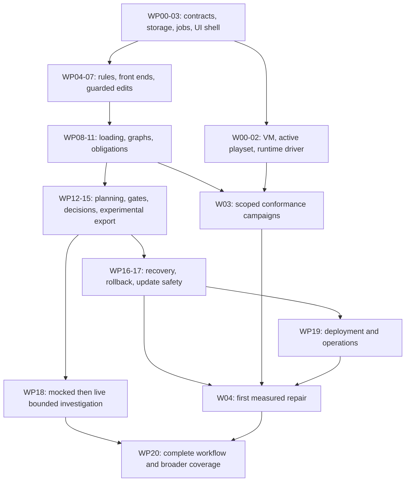

# EU5 Mod Compatibility Engine — implementation plan

Plan date: **27 October 2026**. Status: **proposed implementation plan (P)**, ready to execute in work packages. This plan is derived from specification revision 2.0; it does not establish new EU5 behavior or passing application tests.

**CK3 complete investigations, 30 October 2026:** the accepted
[investigation decision](decisions/0005-complete-ck3-investigations.md) adds bounded
combined evidence, reusable projections, complete concern accounting, structured
reviews, local candidate searches and campaign-version preferences. These improve
file investigation; game testing and broader repairs remain separate milestones.

Implementation has begun. See [IMPLEMENTATION_STATUS.md](IMPLEMENTATION_STATUS.md) for the working application, checks actually executed, implementation decisions, and outstanding Windows/game qualification. The starting-point description below records the state when this plan was written.

**CK3 agent interface, 30 October 2026:** the accepted
[Codex interface decision](decisions/0003-codex-agent-interface.md) replaces the
dashboard as CK3's primary interface. [Agent operations](operations/AGENT.md)
describe delivered inspection/choice/inactive-preparation tools and the remaining
real-game test, activation and undo acceptance milestone. That milestone remains
unfinished and cannot be satisfied by synthetic tests.

**CK3 context and knowledge, 30 October 2026:** the accepted
[startup and knowledge decision](decisions/0004-agent-context-and-knowledge.md)
adds automatic briefings, coordinated checks, resumable objectives, sourced CK3
references and captured-source investigation. The context increment preserves
the earlier real-game acceptance milestone and its separate capability gates.

**CK3 extension, 28 October 2026:** the accepted [Mac-first game-adapter decision](decisions/0002-ck3-mac-first.md)
adds a separate CK3 investigation lane without changing the specification source
package or EU5 milestones. Its first increment delivers game/platform identity,
Steam/launcher discovery and read-only import, immutable snapshots, advisory schema
overlays, source investigation and inactive writer primitives. CK3 loading and
repair capabilities remain unknown/gated pending separately archived Mac/Windows
conformance and complete preservation. See [CK3 operations and coverage](operations/CK3.md)
and the status ledger for executed checks and remaining qualification.

## 1. Starting point and intended outcome

The workspace currently contains the specification package and its assets. There is no application scaffold, dependency lockfile, executable fixture runner, or Git repository. No Windows environment, selected game installation, runtime baseline, or conformance result has been established in this chat.

Build a local, single-user application that inventories an EU5 playset, preserves immutable source bytes, explains effective loading with provenance, identifies lost contributions and conflicting requirements, and produces reviewable repairs with validation, recovery, and rollback. Use Python/FastAPI, React/TypeScript, SQLite, and an optional backend-controlled OpenRouter investigator.

The governing documents are [SPEC.md](../specs/SPEC.md), [ARCHITECTURE.md](../specs/ARCHITECTURE.md), [AGENTS.md](../specs/AGENTS.md), [EU5_SCRIPTING.md](../specs/EU5_SCRIPTING.md), [EU5_LOADING_SEMANTICS.md](../specs/EU5_LOADING_SEMANTICS.md), [TESTING.md](../specs/TESTING.md), [RESEARCH_GAPS.md](../specs/RESEARCH_GAPS.md), and [WIREFRAMES.md](../specs/WIREFRAMES.md). The original research and packaged fixture v1 remain preserved as source material. New implementation contracts belong outside that baseline.

Planning and building the application do not authorize changes to a live game installation. Actual game inputs and a disposable runtime profile must be configured before Windows work can execute. Their absence leaves that lane unrun while independent development continues.

## 2. Non-negotiable implementation contracts

1. **Originals remain read-only.** Vanilla, DLC, local mods, Workshop files, subscriptions, and unknown content are preserved. Writes are restricted to managed application state, snapshots, staging, releases, evidence, and journals.
2. **Raw bytes are authoritative.** The parser preserves all tokens, repeated occurrences, order, comments, malformed regions, encoding/BOM, and newline spelling. Semantic IR never becomes the source serializer.
3. **Evidence stays explicit.** Preserve V/D/C/I/H/P labels. This package supplies zero C-level game rules. Synthetic tests cannot create C evidence; model confidence and user design choices cannot upgrade a rule.
4. **Loading phases remain separate.** File selection, family enumeration, bare registration, six-mode scheduling, ordered bodies, typed readers, and runtime effects are distinct. Preserve all three resource stages.
5. **Preservation uses complete obligations.** Include hidden sources, unrelated definitions, helpers, references, behavior, and downstream operations in the affected closure. Missing ancestry and unknown readers remain unknown.
6. **Edits have exact preconditions.** Bind every structural edit to document hash, occurrence identity/ordinal, byte span, old bytes, profile, and declared effects. Unsupported or recovered regions are ineligible for automatic semantic rewriting.
7. **Only the user resolves genuine design sacrifices.** Present concrete alternatives and exact retained/waived obligations. Bind decisions to current inputs, profile, and proposal; continue independent safe work while a cluster awaits a choice.
8. **Promotion follows deterministic gates.** Every affected obligation is satisfied or narrowly waived. Required unknown/not-run gates and unwaived unknown/violated obligations block validated promotion.
9. **Experimental export cannot activate anything.** It changes neither active-release pointers nor playsets. Synthetic workspaces cannot target real playsets.
10. **Activation is recoverable.** Lock managed targets/playsets before final checks and through verification; journal all resources, detect external changes, retain previous releases, and restore only application-managed changes.
11. **The agent is bounded.** Remote inference is optional. The backend enforces source policy, budgets, tool scopes, staging-only writes, local validation, and provider restrictions.
12. **Claims match coverage.** Parsing, conditional predictions, measured loader behavior, runtime observations, preservation, and user approval remain separate. Clean logs and menu reachability do not establish compatibility.

## 3. Delivery strategy and decision defaults

Run an offline application lane and a Windows qualification lane concurrently. Deliver working UI slices throughout; the design/agent milestone completes the workflow rather than introducing the first usable frontend.

| Checkpoint | Usable result | Capability boundary |
|---|---|---|
| A — source inspector | Configure a synthetic workspace, scan, inspect bytes/CST, coverage, evidence, and loading explanations | Conditional predictions; no game-directed validated promotion |
| B — deterministic planning | Stage safe synthetic repairs, resolve design choices, run full-stack gates, export experimental bundles, exercise recovery | Experimental bundles remain inactive; no unmeasured production repairs |
| C — first measured repair | Packaged Windows application and a small explicit allowlist of conformed repair adapters | Exact build/family/field scope; complete affected obligations still required |
| D — complete application workflow | Optional bounded OpenRouter investigation, all wireframe states, update/rebase, deployment and support flows | Agent proposals use the same local gates as deterministic proposals |
| E — broader measured coverage | Additional event, hook, GUI, setup, language, and content-source adapters | Each capability earns its own conformance; unknown content remains supported as opaque inventory |

The first measured repair checkpoint is a useful intermediate delivery. Full implementation includes the remaining application, agent, update, and family work; narrow production coverage does not remove those tasks from the roadmap.

Implementation defaults below are proposed project decisions. Record them in architecture decision records during WP00, and revise through an explicit documented decision when evidence warrants it.

| Area | Starting decision | Reason / review point |
|---|---|---|
| Runtime | One local FastAPI service serving the compiled React app; loopback binding, installation session capability, mutating-request origin checks | Matches local solo-use deployment; verify Windows packaging early |
| Background work | Persistent SQLite job coordinator with supervised local workers; one coordinator/writer owner per workspace | Avoid an unnecessary external queue; isolate long parsing/probes from request handlers |
| Storage | Content-addressed immutable blobs plus SQLite records and versioned manifests | Raw bytes are authoritative; indexes can be rebuilt |
| Parsing | Python byte scanner and ordered CST; separate family front ends and semantic lowering | Implements exact source preservation without dictionary serialization |
| Graphs | Typed relational nodes/edges queried through bounded graph services | No separate graph database is needed initially; measure query performance |
| API | Strict Python transport models, OpenAPI, generated TypeScript contracts, shared schema versions | One contract source; reject invalid client/model payloads locally |
| Rules | Immutable content-hashed synthetic, documentation-only, and conformed profiles | Scope, evidence, unknowns, and allowed capabilities are explicit |
| UI | Overview, investigation, decisions, validation/recovery, rules/evidence; shared source/diff/status components | Follow the supplied wireframes and required states |
| Windows execution | Same domain core with replaceable native discovery, playset, filesystem, and bounded runtime adapters | Required deployment remains the Windows VM; another host requires a recorded project decision |
| Tooling | Select and lock compatible Python/Node runtimes, package/build tools, test tools, and third-party licenses in WP00 | Verify current official support and Windows compatibility before adoption; no versions are assumed by this plan |

Start with whole-file parse caching and bounded relational queries. Add finer incremental parsing, extra worker concurrency, or specialized storage only after measured bottlenecks justify them.

## 4. Repository and domain structure

```text
backend/
  app/api/                         # transport models, routes, auth, SSE
  core/
    snapshots/ parsing/ semantics/ loading/
    evidence/ planning/ validation/ releases/
  adapters/
    filesystem/ windows/ playsets/ script_docs/ openrouter/
  workers/                         # supervised jobs and game worker
frontend/src/
  screens/ components/ api/ state/
schemas/                           # versioned transport, fixture, probe, evidence contracts
profiles/
  synthetic/ documented/ conformed/
tests/
  contract/ property/ integration/ ui/ agent_replays/
  conformance/ packaging/ recovery/
docs/
  IMPLEMENTATION_PLAN.md
  decisions/                       # architecture decisions and approved host changes
  development/ operations/
specs/                             # preserved research/specification baseline
```

Managed runtime data lives outside packaged code and source roots: SQLite, blobs, snapshot manifests, profile copies, jobs, staging, releases, evidence, journals, and the active-release manifest. A live database uses a supported local filesystem; VM/shared-folder storage requires a separately tested policy.

Establish these shared contracts before component implementations diverge:

- Workspace/target discriminator (`synthetic` or `game`), source identities, allowed managed roots, captured fingerprints, ordered playset, and snapshot consistency.
- Byte spans and position maps; CST occurrences and edit preconditions; raw/structural/effective hashes with distinct types.
- Immutable rules, scopes, evidence dependencies, contradictions, experiment recipes/results, and capabilities.
- `Known`, `Unknown`, and `Invalid` values; graph edges with reference certainty; ordered loading transitions.
- Intent baselines/obligations, findings/clusters, plans/candidates, decisions, read/write sets, and invalidation dependencies.
- Gate plans/results with independent requiredness and `pass`, `fail`, `unknown`, `not_run`, `not_applicable` outcomes.
- Job/event records, mutation idempotency, candidate revisions, release manifests, journal states, and rollback previews. Candidate lifecycle is `draft → staged → validating → ready | blocked | stale`; export/promotion records remain separate.

Every derived generation pins snapshot, profile, parser, schema, and relevant docs fingerprints. UI requests pin one committed generation; incomplete scans never replace it.

Implement the minimum API progressively, using the exact contracts in [ARCHITECTURE.md §6](../specs/ARCHITECTURE.md#6-service-contracts):

| Endpoint | Delivering packages |
|---|---|
| `POST /api/workspaces` | WP03 |
| `POST /api/workspaces/{id}/scans` | WP03 shell; WP08–WP11 analysis |
| `GET /api/jobs/{id}` and `/api/jobs/{id}/events` | WP03 |
| `POST /api/jobs/{id}/cancel` (supporting extension) | WP03; cooperative cancellation, idempotent repeats, retained incomplete evidence |
| `GET /api/scans/{id}/findings` | WP11/WP14 |
| `GET /api/scans/{id}/definitions/{key}` | WP09–WP10 |
| `GET /api/evidence/{id}` | WP04 |
| `POST /api/clusters/{id}/investigations` | WP11–WP12 deterministic jobs; WP18 optional agent |
| `POST /api/plans/{id}/decisions` | WP14 |
| `POST /api/plans/{id}/stage` | WP12 |
| `POST /api/candidates/{id}/validate` | WP13 |
| `POST /api/candidates/{id}/export` | WP15 experimental; WP16/W04 validated managed release |
| `POST /api/releases/{id}/rollback` | WP16; explicit preview/apply payloads |
| `GET /api/workspaces/{id}/coverage` | WP06/WP09/WP14 |

Define supporting configuration/source/profile/worker contracts in WP01 as their consumers are introduced. All mutations use idempotency and expected revisions; paths are display data rather than authority. Model tools call domain services through the same policy boundaries instead of acquiring a second write path.

## 5. Dependency map and execution lanes



This diagram shows gate dependencies, not a prohibition on incremental work. WP19 starts with an early Windows smoke build. WP17 invalidation hooks begin with the first cache/plan. UI work begins in WP03 and grows through WP14. Windows feasibility begins immediately with available licensed inputs; initial evidence can be captured manually before the harness is complete.

Separate implementation readiness from capability enablement. WP13 first qualifies gate policy with local adapters/mocks; WP15 implements an internal exporter before user-facing repair export is enabled; WP16–WP17 then complete recovery/update integration. The M3 gate enables experimental repair export only after the complete F01–F20 core contract/no-write suite passes, including F17 local proposal rejection and F19 recovery. WP18 later adds full orchestration replays to F17 at M5. This avoids making exporter implementation depend on recovery code that itself needs exporter contracts. Validated game-directed promotion remains gated separately by W04.

Suggested parallel ownership is: storage/service/contracts; parser/loading/semantics; UI/planning; Windows/evidence/release verification. Shared schemas and immutable boundaries must land before dependent implementations. With fewer contributors, preserve the same dependency order and alternate between vertical slices. Avoid concurrent edits to a shared schema without a named owner.

## 6. Offline application work packages

Each package produces code, applicable regression coverage, contract/documentation updates, and an evidence-backed completion note. Its tests are implementation work to be executed later; this plan does not mark any as passing.

### WP00 — Bootstrap and engineering decisions

**Dependencies:** specification review; no application dependencies.

- Initialize version control and preserve the supplied spec/source assets. Add root contributor guidance that points to the governing contracts.
- Create backend/frontend workspace, reproducible local commands, compatible runtime/toolchain locks, formatting/type/lint checks, and macOS/Windows CI configuration.
- Record decisions for worker supervision, SQLite writer ownership/migrations, API/type generation, frontend state/source editor, packaging, and third-party licensing. Verify official current support when selecting dependencies.
- Define command names for setup, development, build, schema generation/checking, contract/unit/property/UI/replay/recovery tests, and packaging smoke. Document prerequisites and fixture-only operation.

**Exit:** a clean checkout can install locked dependencies and start an offline loopback API/UI on macOS; Windows scaffold smoke is available for W00. Source data and secrets are excluded from public artifacts.

### WP01 — Shared contracts, fixture v2, and runner skeleton

**Dependencies:** WP00.

- Define the shared records from section 4, strict enum/union validation, schema versions, generated TypeScript transports, and a schema drift check.
- Preserve the supplied fixture v1 unchanged; introduce a new schema revision with explicit disposition, strict base64, hashes, typed expectations, ancestor/independence prerequisites, and mandatory conformance fingerprints where applicable.
- Implement a temporary-root materializer, synthetic profile, golden comparison tooling, and contract/conformance tier separation. Unsafe paths are rejected before materialization.
- Define `effective_before_patch`, reserved empty generated-patch slot, post-patch effective state, and explicit no-patch behavior. Migrate fixture 003 into the new contract without changing its meaning.

**Exit:** fixture 003 can be decoded, validated, and materialized safely; invalid manifests produce typed failures and no writes. Schema/type generation is deterministic. The runner initially reports unimplemented stages explicitly.

### WP02 — Managed filesystem, immutable snapshots, and Windows path policy

**Dependencies:** WP01.

- Centralize source-read and managed-write capabilities. Reject overlapping roots, traversal, absolute/drive/UNC/device/ADS archive paths, path aliases, and escapes through symlinks/junctions/reparse points.
- Use opened-handle containment/no-follow traversal or controlled link-free staging; string validation alone is insufficient against races.
- Implement blob hashing, stable before/after inventory checks, source manifests, complete/incomplete snapshot status, and consistent retries after mid-scan changes.
- Retain raw path spelling separately from target Windows comparison/search keys. Model pathological names in manifests; do not create unsafe files to test rejection.

**Exit:** F14–F16 foundation cases pass; outside-root sentinels and originals remain unchanged under race/failure tests. Updates cannot publish mixed snapshots. Identical manifests have deterministic hashes across hosts, subject to W01 calibration.

### WP03 — SQLite, persistent jobs, API shell, and first UI slice

**Dependencies:** WP01–WP02.

- Implement migrations, foreign keys, bounded transactions, coordinated writer ownership, consistent backups, and atomic publication of complete derived generations.
- Add persistent `queued`, `running`, `completed`, `failed`, `cancelled`, `awaiting_user` jobs and resumable SSE with event IDs. Reconcile interrupted jobs on restart; supervise long-running work outside request handlers.
- Enforce loopback defaults, session capability, origin checks, opaque IDs, bounded reads, pagination, mutation idempotency, expected revisions, and structured `409` responses.
- Deliver workspace configuration, synthetic labeling, inventory/progress, worker health, cancellation, and restart/reconnect UI. Show real phase/unit progress.

**Exit:** offline workspace → snapshot scan → committed inventory works through the UI. Cancellation/restart never publishes partial results or repeats mutations. Invalid origins and unauthorized paths fail. Backup/restore reproduces DB state and referenced blobs.

### WP04 — Evidence registry, immutable profiles, and installed-doc importer

**Dependencies:** WP01–WP03; actual installed docs are optional inputs supplied through W01.

- Implement source revisions, V/D/C/I/H/P distinctions, contradictions, experiment states, immutable profile revisions, explicit selectors, capability flags, and reverse dependencies.
- Ship the synthetic profile and a documentation-only research profile with production export disabled. Empty selectors mean no production applicability.
- Import versioned generated script docs/data-type dumps into typed vocabulary, scopes, and signatures. Missing/incomplete docs reduce coverage; never substitute another game's schema.
- Expose evidence queries and a rule-browser UI showing caveats, scope, zero conformed rules, contradictions, and dependent results.

**Exit:** a documentation or synthetic record cannot be promoted to C through configuration, model output, or user preference. Production-enabled rules without scoped artifacts are rejected. Profile/docs changes invalidate dependent results while historical evidence remains readable.

### WP05 — Byte scanner, ordered CST, recovery, and positions

**Dependencies:** WP01–WP02; profile/dialect identities from WP04.

- Implement lexical modes for script, quotes, comments, bracket expressions, and supported template/code bodies; longest-match operators; exact scalar and escape spelling.
- Preserve repeated properties, bare/mixed lists, tagged blocks, declaration heads, GUI heads, macros, trivia, opaque regions, and errors. All original bytes are covered by tokens.
- Add bounded recovery and limits for bytes, tokens, nesting, diagnostics, expansion, and time. Recovered/limited analysis remains visibly incomplete.
- Implement byte/code-point/UTF-16/display position conversion and exact decimal derived views. Keep raw, structural, and effective hashes distinct.

**Exit:** no-op serialization equals every original input byte, including malformed/invalid-byte cases. F06/F07 syntax and F13/F14 regressions, bounded property tests, quote/backslash/operator adjacency, and position tests pass on both host lanes. No command reordering or numerical normalization occurs.

### WP06 — Family front ends and conservative semantic lowering

**Dependencies:** WP04–WP05.

- Dispatch by stage/path/signature/profile, with separate lossless metadata JSON, Paradox localization, GUI grammar, registered table adapters, and opaque binary/unknown handling.
- Preserve localization headers/revisions/interpolation, metadata unknown fields, GUI types/templates/inheritance/bindings, filename semantics, and family-specific BOM/newline policies.
- Lower typed declarations/references/scopes/macros without rewriting raw source. Preserve dynamic and unsupported constructs explicitly.
- Implement bounded auxiliary macro expansion with call/definition provenance; ordered values; variable owner/storage/lifetime; file-local helper visibility. Arithmetic/scope questions remain symbolic pending measurement.

**Exit:** F11–F14 and relevant F20 syntax/dispatch cases pass. Unsupported content is inventoried and preserved. Metadata is never parsed as script, localization never ordinary-YAML serialized, and binaries never semantically rewritten by the script parser.

### WP07 — Guarded structural editing engine

**Dependencies:** WP02, WP05–WP06.

- Implement scalar replacement, occurrence append/remove, ordered insertion, and definition-body replacement with exact hashes, spans, occurrence selectors, old-byte preconditions, and declared effects.
- Resolve edits against one immutable snapshot, reject overlaps/stale/ambiguous targets, order shared-boundary insertions explicitly, and apply using original byte coordinates.
- Reparse outputs, verify unchanged ranges, preserve ambiguous adjacent comments, and expose exact source/structural diffs. Recovered/unknown regions reject automatic semantic edits.

**Exit:** repeated-occurrence edits target only the intended occurrence; stale hashes and ambiguous alignment write nothing. Surgical byte locality, encoding/position preservation, cancellation, and deterministic output regressions pass.

### WP08 — Discovery contracts and stage-aware VFS

**Dependencies:** WP02, WP04, metadata support from WP06; native adapters integrate through W01.

- Inventory vanilla, DLC, local/Workshop mods, selected enabled order, baselines, and user overlays using distinct package/Workshop/path identities.
- Implement profile-driven exact-path selection and `replace_paths` masks. Keep all candidates and shadow/mask explanations; only surviving files enter active loading.
- Partition by `loading_screen`, `main_menu`, `in_game` and explicit family. Keep unknown extensions/folders as coverage findings.
- Separate installed presence, enabled state, relationship metadata, versions, and ordering constraints; dependency cycles need their actual semantics before classification.

**Exit:** F08/F10/F15/F16 path/order/dependency cases pass. Shadowed unrelated definitions remain inspectable for intent analysis. Unconformed mask/overlay/path rules yield conditional/symbolic outcomes rather than host-order defaults.

### WP09 — Definition operations, scheduling, readers, and provenance

**Dependencies:** WP04–WP06, WP08.

- Extract bare creation and eligible top-level six-prefix operations with raw keys, occurrence ordinals, source spans, stage/family visibility, and rule dependencies.
- Implement separate registration/enumeration/scheduling/transition/reader layers. Preserve failed, ignored, erased, and suppressed contributions in the explanation graph.
- Implement the declared synthetic readers and modes; real-game profiles require explicit scoped rules. Bound unknown alternatives without choosing a hidden fallback.
- Expose effective bodies separately from interpreted fields, with every decisive rule and source occurrence navigable.

**Exit:** F01/F02/F05/F07/F08 permutations pass, including every mode/presence pair, all relevant synthetic mode pairs, duplicate creates, same-mode order, traversal, erasure, and unknown-reader variants. A late injection cannot survive a later replacement through filename alone.

### WP10 — Typed semantic index and four graphs

**Dependencies:** WP04–WP06, WP08–WP09; declaration indexing can begin before complete loader integration.

- Build package, definition, operation, and conservative behavior graphs. Index active and hidden sources distinctly.
- Track literal/expanded/dynamic/unknown references; namespace/stage/family/visibility; event/helper closure; GUI/localization/asset edges; callbacks, scope transitions, and variable reads/writes.
- Implement bounded searches, source-span reads, reference queries, definition histories, and dependency/reverse-dependency closure services.
- Represent hardcoded entry points and unresolved dynamic uses conservatively. Lack of incoming edges does not prove unused content.

**Exit:** F09/F10/F12/F18/F20 cases find transitive A+B+C interactions and missing literal helpers without inventing targets or false missing-reference errors for dynamic names. Queries retain exact provenance and paginate large results.

### WP11 — Intent ancestry, obligations, conflict clusters, and findings

**Dependencies:** WP09–WP10.

- Import/pin exact author baselines when available; distinguish current vanilla from historical ancestry and classify unavailable baselines explicitly.
- Derive supported deltas/deletions and preservation predicates, retaining unproven behavior. Align repeated occurrences only when evidence supports a unique alignment.
- Build complete connected clusters and affected obligation closure across all four graphs, including hidden/unrelated contributions and downstream operations.
- Implement the five finding categories with independent impact, certainty, coverage, runtime requirements, repairability, lost intent, and order sensitivity.

**Exit:** fixture 003 explains the lost x contribution; F04 exact-value contradiction and F20 execution conflicts remain design findings. Unknown ancestry/reader/reference cases remain unproven. No obligation is dropped to make a plan appear eligible.

### WP12 — Deterministic planner and immutable candidate staging

**Dependencies:** WP07, WP11.

- Implement identity/no-op, proven independent baseline-relative changes, and only those composition transforms with established reader/order/multiplicity preconditions.
- Prefer a generated patch; construct isolated managed-copy/replacement-playset plans when the measured loader cannot express a safe patch. Retain the complete file/helper/dependency closure.
- Freeze source/profile/decision prerequisites, read/write sets, allowed effects, expected results, obligations, and output hashes into new candidate generations.
- Simulate the original and complete final stack, including generated files and downstream operations. Never infer numeric deltas, average/sum conflicting targets, deduplicate callbacks, or automatically rename dynamic uses.

**Exit:** F03 produces x=2/y=3 only with pinned ancestry and independent readers. F03 negative, F04 unresolved, F05 unknown, F06 ambiguous, F18 unrelated-content, and F20 multiplicity cases stage nothing unsafe. Originals remain unchanged.

### WP13 — Deterministic validation policy and full-stack gates

**Dependencies:** WP04, WP10–WP12; runtime gates integrate through W02–W03.

- Compute the gate plan from candidate capabilities and the complete affected dependency/obligation closure; the model cannot select a smaller required set.
- Evaluate consistency, strict supported syntax, encoding/naming/metadata, Windows paths, references/scopes, final loading, expected results, write sets, preservation, runtime observations, and current decisions independently.
- Persist immutable reports with exact requiredness/outcomes and explanations. Required unknown/not-run gates and unknown/violated unwaived obligations block readiness.
- Expose precise failures for planner/agent revision; neither parse success nor a clean runtime log can override gate policy.

**Exit:** gate-policy assertions for F01–F20 pass against local adapters/mocks, including proposals that parse but suppress a contribution. Omitted obligations and model-supplied optional flags cannot enable promotion. Integrated recovery/update tests finish in WP16–WP17 before M3 export enablement; the complete agent-loop replays finish in WP18 before M5 inference enablement.

### WP14 — Complete review, decision, and validation UI

**Dependencies:** begins in WP03; overview/evidence grow with WP04/WP09; completes with WP11–WP13.

- Implement all five wireframe screens with shared source, textual/structural/effective diff, loading trace, obligations, and evidence views.
- Provide concrete alternatives, custom designs, keep-unresolved, no preselected lossy choice, and hash-bound narrow decision records. A pending cluster does not stop independent work.
- Cover every required workspace/finding/investigation/decision/candidate/export/recovery state. Export/recovery screens initially use contract-backed mocks until WP15–WP16 services exist. Keep unknown coverage visible through filters.
- Add keyboard navigation, focus, semantic tables, text equivalents for graphs, resizable panes, copyable diagnostics, pagination, and accessible progress/failure announcements.

**Exit:** a user can complete scan → explain → stage → choose a design where required → validate → inspect blockers without developer tools. F04 stale/current approvals pass real service/browser checks. All wireframe states pass rendering/accessibility checks; export/recovery states are explicitly mocked at this point. Real export/recovery integration is qualified in WP15–WP16, runtime integration in W04, and the complete state matrix in WP20.

### WP15 — Experimental bundles and review manifests

**Dependencies:** WP12–WP14 for exporter implementation. User-facing repair export enablement additionally requires WP16–WP17 and the complete M3 F01–F20 core checks; no live agent integration is required to test invalid local proposals.

- Export immutable review/probe bundles containing generated bytes, target-derived metadata, placement/order instructions, hashes/versions, obligations, decisions, reports, outstanding gates, and rollback references where applicable.
- Recheck path/snapshot/edit preconditions; retain `unknown`/`not_run` outcomes and visible unvalidated labeling.
- Enforce separate `experimental_bundle` and `validated_managed_release` result types. Synthetic bundles cannot target real playsets.

**Exit:** internal export/import inspection reproduces exact bytes and manifests; malformed/stale/unsafe requests fail. Tests prove experimental export leaves both playsets and active-release pointers untouched. The UI/API capability stays disabled until the separate M3 enablement gate passes.

### WP16 — Journaled promotion, recovery, and exact rollback

**Dependencies:** WP13–WP15 and WP17 precondition/invalidation hooks; game-directed use additionally requires relevant W03 evidence and W01 playset qualification.

- Implement `prepared`, `validated`, `promotion_started`, `files_active`, `playset_applied`, `verified`, `rolled_back`, and `recovery_required` journal states with recovery actions for every boundary.
- Acquire cross-process managed-target/playset locks before final checks and retain through verification. Check source/profile/decisions/target/playset state, durably journal before activation, publish complete managed generations, then verify actual state and externally mutable source hashes.
- Enable playset writes only through a qualified adapter. Otherwise export a concrete activation plan, track awaiting manual activation, and verify application through the in-game UI before claiming active success.
- Preview exact rollback, previous/current hashes, application-made playset changes, and intervening edits. Restore only owned changes; preserve evidence and old releases.

**Exit:** injected failures at write/backup/flush/manifest/DB/pointer/playset/cleanup boundaries recover a coherent generation or explicit reconciliation state. Low disk, locks, cancellation, competing processes, and source changes during activation never yield validated success. External destination edits are never silently overwritten.

### WP17 — Invalidation, update/rebase, and historical reproduction

**Dependencies:** hooks begin in WP02/WP04; complete behavior depends on WP09–WP14.

- Track complete read sets and reverse dependencies for parser/docs/rules, source/helper/ancestor bytes, enabled order, executable/content/DLC/overlays, decisions, and schemas.
- Invalidate affected scans, plans, candidates, approvals, and capabilities on changes. Retain only demonstrably independent results; display stale reasons and changed identities.
- Rebase to new immutable snapshots/candidates with renewed affected decisions and gate plans. Retain prior profiles/evidence/releases for explanation and rollback.
- Quarantine contradictory conformance rules immediately; propagate capability loss to every dependent automatic export.

**Exit:** invalidation tests pass independently; joint WP16–WP17 acceptance completes F19 and stateful scan/update/plan/validate/update/export/rollback sequences. Same display version with changed bytes invalidates correctly; unrelated thumbnail updates retain validity only with a dependency proof.

### WP18 — Bounded OpenRouter investigator: offline executor first

**Dependencies:** WP03–WP04, WP07, WP10–WP14; probes depend on W02 and remain unavailable without a qualified worker.

- Implement bounded `search_sources`, `read_spans`, `show_definition_history`, `get_effective_definition`, `find_references`, `inspect_rule_evidence`, `propose_structural_edit`, `validate_candidate`, and `run_game_probe` tools against pinned IDs/scopes.
- Build a fully offline replay/mock loop before live inference. Validate schemas/tool IDs/completed arguments, budgets, idempotency, source hashes, write sets, privacy exclusions, credentials redaction, and policy across retries/fallback providers.
- Allow independent reads concurrently; serialize overlapping mutations and probes. Never execute partial streamed arguments or grant arbitrary filesystem/shell, source writes, design waivers, active-playset changes, or direct promotion.
- Add provider/model endpoint capability checks, configured source disclosure, per-job budgets, cancellation, and redacted transcripts keyed by cluster/baseline/rules/prompt/tool/model/provider fingerprints.

**Exit:** F17 and adversarial replays pass for injection, malformed/partial JSON, unsupported tools/arguments, wrong IDs, repeated calls, context growth, rate limits, timeouts, exhausted budgets, provider mismatch, excluded excerpts, and confident lossy proposals. Optional live evaluation uses explicit budgets and the identical local gates.

### WP19 — Packaging, backups, diagnostics, and operations

**Dependencies:** early smoke starts at WP03 with W00. The core build-ready subgate integrates WP15–WP17 and W02, then supplies the package tested by W04. Final deployment/operations acceptance incorporates W04 results downstream; W04 is not a prerequisite for producing its own test build. Agent support is added after WP18 without blocking the first measured core checkpoint.

- Package pinned backend/frontend and provide one local startup flow, health/status, writable-state separation, migrations, consistent DB/blob backup/restore, and reversible application updates.
- Run macOS development setup and clean Windows installation/upgrade/restart/offline smoke; keep live SQLite off unqualified shared/network storage.
- Add redacted diagnostic exports, source-excerpt exclusions, job/release/evidence retention controls, disk-usage reporting, and safe cleanup. No automatic retention deletion of originals, retained releases, or referenced evidence before policy is defined.
- Benchmark a declared corpus by files/bytes/coverage, cold/warm timings, peak memory, host/VM resources, and phase. Set performance targets from those measurements; preserve responsiveness/cancellation.

**Build-ready subgate:** a clean Windows package can run fixtures, scan configured content, execute a qualified W02 probe, restart/recover, back up/restore, and reverse an application update. It is available for W04 qualification. **Final exit:** integrate W04 deployment results and enabled WP18 features; diagnostic exports contain no secrets/excluded snippets, and performance results/limits are recorded.

### WP20 — Broader adapters and full application acceptance

**Dependencies:** WP01–WP19 for applicable features; W03 campaigns and W04 for measured game capabilities.

- Complete the family capability roadmap in section 9 and all required end-to-end UI/API/agent/update/deployment flows. Each new adapter reuses the same byte, evidence, obligation, gate, and release contracts.
- Keep unmeasured fields/families opaque or symbolic and visible. Scope automatic transformations narrowly; binary inventory/reference/choice support does not require inventing a binary merge engine.
- Exercise the full requirement traceability matrix, Windows installation/runtime scenarios, recovery, update/rebase, and offline operation from a clean checkout/package.
- Publish a capability ledger: implemented analysis, conditional prediction, staged transforms, measured production scope, unsupported regions, actual results, and remaining probes.

**Exit:** all R01–R15 application requirements have passing evidence for the declared release; all F01–F20 families and required negative variants pass on both platforms; every enabled production adapter has relevant current conformance and complete preservation coverage. Remaining broader EU5 questions are explicit, with capabilities disabled where necessary.

## 7. Concurrent Windows work packages

These packages require the actual selected installation and environment. They are scheduled work, not facts already established. Missing inputs leave the specific work pending and cannot turn game gates green.

### W00 — VM feasibility and initial baseline

**Dependencies:** selected licensed installation, Windows VM, disposable user/test profile; WP01 evidence shape. Manual capture can start before the harness.

- Record VM/Windows/CPU/RAM/GPU/driver environment, actual executable/content/DLC fingerprints, settings, and baseline profile. Prove the game initializes and reaches declared menu/lobby/campaign milestones appropriate to the intended tests.
- Archive raw logs and direct milestone evidence; distinguish infrastructure failure from mod failure.
- Run the early loopback API/UI/storage smoke from WP03/WP19. If the VM fails game initialization, record the blocker and prepare the same worker contract for an alternative Windows host; changing the deployment host needs a recorded project decision.

**Exit:** actual game baseline and app scaffold evidence exist for the chosen VM, or failure is explicitly recorded with no game-validation claim. macOS development proceeds independently.

### W01 — Native sources, filesystem, and active-playset qualification

**Dependencies:** WP02/WP08 contracts, W00 environment, disposable profile.

- Resolve Documents through known-folder APIs and enumerate all Steam libraries, vanilla, installed/enabled DLC, local/Workshop mods, and user overlays. Capture installed docs/data types for WP04.
- Calibrate Windows path/lock/rename policy on native NTFS and VM shared folders, including aliases, long paths, Unicode user folders, reserved names, junctions, and interference.
- Start with read-only playset adapters. With the game closed, snapshot relevant filenames/hashes and schemas; through game UI independently create/apply AB, reverse order, disable B, and select another playset. Preserve unknown fields and unrelated state.
- Correlate persistence with actual active sentinel content and metadata/Workshop/path identities. Qualify write/backup/restore/concurrency/crash behavior separately before enabling any write adapter.

**Exit:** exact active content/order is demonstrable for the measured build; read-only discovery is reliable; policy is calibrated. Unqualified persistence keeps automatic activation disabled and uses explicit in-game UI instructions.

### W02 — Controlled runtime driver and observation pipeline

**Dependencies:** WP02–WP04, W00–W01; private seed and probe contracts.

- Give one worker exclusive ownership of launches and its test profile. Implement allowlisted recipes, valid private-seed materialization, bounded waits, milestones, cooperative cancellation, restoration, and incomplete-run archival.
- Qualify commands and observation methods on the target; do not assume headless/parse-only flags or inherited CLI behavior. Manual UI checkpoints may participate in explicitly recorded runs.
- Archive emitted bytes, source maps, active playset before/after, fingerprints, commands, raw logs, screenshots/saves/probe results, assertions, and remaining limitations.
- Compare diagnostic multisets by stage/severity/count against baseline and individual mods. Build log parsers from observed examples. Detect open failures separately from encoding failures.
- Run E25 crash/active-state controls early enough to qualify evidence from later campaigns; hot reload remains a separate scope.

**Exit:** baseline/A/B/AB/BA/repaired cold-start protocols can be executed where relevant, with direct discriminating observations and negative controls. Unconfirmed active content, changed inputs, unexpected crash, or missing observations yields incomplete/inconclusive evidence and cannot promote a rule.

### W03 — Scoped conformance campaigns and profile promotion

**Dependencies:** W01–W02, WP04/WP09/WP10 and each relevant adapter. Campaigns can run as soon as their prerequisites exist.

Before a run, record competing predictions and the controlled axis. Use private valid installation seeds, keeping unrelated controls/dependencies intact. Archive raw evidence and restore the baseline. Review result scope, failure behavior, repetitions/variability, and residual unknowns before creating an immutable C-bearing rule revision. A contradiction quarantines the rule and invalidates dependent capabilities/plans.

| Campaign | Experiments | Observation / capability earned |
|---|---|---|
| Loading foundation | E01 exact-path/playset; E02 filenames; E03 traversal; E04 all 36 mode pairs; E05 bare phase; E06 duplicate creation; E07 absent targets/failure scope | Per-family VFS/enumeration/registration/mode behavior; no universal create-first default |
| Typed readers | E08 scalar repetition; E09 nested/trigger/effect repetition and replacement erasure; E10 scripted declarations; E11 modifier versus price | Exact field reader, multiplicity/order, and supported composition semantics |
| Events and hooks | E12 event duplicates/vanilla overrides; E13 helper closure; E14 on-action field/callback composition | Resolve retained contradictions; observe actual options/effects and callback counts |
| UI/text and resource identity | E15 localization tiers/ties; E16 GUI identities; E17 masks; E18 cross-stage visibility | Family-specific selection, visibility, and composition boundaries |
| Platform/setup/content sources | E19 case/Unicode; E20 setup managers; E21 encoding; E22 overlay/DLC | Target path policy, per-manager loading, family-specific writers, complete source precedence |
| Runtime language | E23 arithmetic/conversion; E24 scopes/existence/maps | Exact supported evaluator or rewrite prerequisites; unsupported expressions remain symbolic |
| Driver trust and recovery | E25 restart/hot reload/crash-driven playset changes | Trustworthy active-state checks and cold-start evidence; repeat for affected families/builds |

**Exit per rule:** exact executable/content/docs/DLC/stage/family/field applicability, discriminating controls, direct observations, artifact hashes, diagnostics/failure scope, and invalidation dependencies are present. An E-number passing once never grants every database or field that rule.

### W04 — First measured repair and production capability gate

**Dependencies:** WP12–WP17, core release build from WP19, W00–W03 for the selected allowlist.

- Select the first eligible families from measured coverage, likely a small database subset plus defines/metadata/localization as justified. Selection follows evidence and complete dependency closure rather than historical examples.
- Execute clean baseline, individual mods, original stack, and repaired stack; include relevant both-order variants, menu/lobby/campaign/target/GUI/locale/save scenarios according to obligations.
- Verify packaged deployment, current gates/decisions, managed promotion, actual activation, source hashes, fault recovery, and exact rollback. Recheck actual active state after failures.
- Publish measured scope and remaining unknowns separately from the full application's implemented features.

**Exit:** an actual multi-file managed repair can be staged, validated, activated through qualified means, interrupted/recovered, and exactly rolled back without modifying originals. Every claimed contribution has satisfied or current narrowly waived obligations; unsupported dependencies cannot be omitted to enable release.

## 8. Test delivery and verification policy

Build tests alongside the boundary they exercise. Expand or repeat checks when new behavior, failures, or concerns justify it. Documentation, unit tests, synthetic contracts, Windows observations, and live-provider evaluations remain separate evidence lanes.

| Fixture | Implementation owner / introduction | Essential positive and negative outcome |
|---|---|---|
| F01 independent mods | WP09; integrated WP13 | Both contributions, either order; no patch or model calls |
| F02 identical overrides | WP09/WP11 | Compatible overlap; retain ownership/occurrences; no source cleanup |
| F03 disjoint fields | WP01/WP11–WP13 | x2/y3 only with pinned ancestor/independence; missing prerequisites write nothing |
| F04 contradictory values | WP11/WP14 | Concrete current user choice and exact waiver; unresolved/stale choices block |
| F05 nested collisions | WP09/WP12 | Repeated blocks retained; unknown reader blocks; replacement erasure is distinct |
| F06 repeated keys/effects | WP05/WP07/WP12 | Correct occurrence/order; ambiguous alignment blocks |
| F07 modes/missing targets/duplicates | WP05/WP09 | Six-mode presence matrix and explicit duplicate policy; ineligible colons are not operations |
| F08 loading axes | WP08/WP09 | Separate exact-path, filename, traversal, playset, stage, and mode permutations |
| F09 references | WP10/WP11 | Missing literal helper closure; dynamic targets remain unresolved |
| F10 dependencies | WP08/WP10 | Installed/enabled/version/order distinct; only proven strict-order cycles contradict |
| F11 localization | WP06/WP09/WP14 | Dedicated parsing, languages/tiers/occurrences, explicit design choices |
| F12 GUI | WP06/WP10/WP12 | File and symbol identity distinct; whole-file unrelated widgets preserved |
| F13 malformed syntax | WP05/WP07 | Exact raw recovery; no semantic edit through errors |
| F14 encodings/positions | WP02/WP05–WP07 | BOM/newline/invalid bytes and byte/code-point/UTF-16 distinctions |
| F15 Windows aliases | WP02/WP08/W01 | Manifest-only hazards; measured target comparison; no blind rename |
| F16 unsafe paths/links | WP01–WP03/WP07 | Reject before materialization; sentinels unchanged under link races |
| F17 invalid agent output | WP13/WP18 | Syntax-valid lossy edits rejected; budgets/privacy/tool authority enforced |
| F18 unrelated contributions | WP10–WP13 | Full file/helper/unknown contribution preservation; no cleanup deletion |
| F19 updates/stale plans | WP16–WP17 | Concurrent changes, stale approvals, rollback preconditions, exact restoration |
| F20 assets/runtime meaning | WP06/WP10–WP14/W03 | Equal/unequal opaque assets, explicit choice, observed execution multiplicity |

Every matrix family requires exact byte inputs and goldens for applicable parse, diagnostics, findings, effective state, provenance, obligations, output, disposition, and no-write behavior. Row labels are not implementations. Preserve meaningful differences when updating goldens; normalize only transient IDs and temporary host roots.

Additional verification lanes:

- **Unit/property:** bounded malformed/Unicode/repeated-syntax generators; exact no-op, contained spans, edit locality, termination, and stateful update/export/rollback sequences.
- **Differential:** compare neutral projections with pinned parsers only within common coverage; disagreements become triage cases, not game truth.
- **Service/UI:** SQLite migrations/backups, generation-pinned queries, strict schemas, auth/origin, SSE replay, cancellation/restart, API idempotency, keyboard/focus and all wireframe states.
- **Agent replays:** deterministic offline orchestration with no live key/spend; live-model evaluation is a separate budgeted lane with provider/model metadata.
- **Recovery:** cross-process locks, every journal boundary, source changes during activation, external destination edits, low disk, permissions, cancellation, and process termination.
- **Cross-platform:** the same manifests/hashes on macOS and Windows; native APIs/NTFS calibration and packaged Windows smoke.
- **Conformance:** private valid seeds and actual observations from W03; each rule's scope and artifacts reviewed independently.

Public CI contains synthetic data/recipes only. Private installation corpora, proprietary seeds, saves, and source-bearing evidence stay in managed private storage. Retention and backup preserve the evidence required to understand active/historical releases.

## 9. Family capability roadmap

Every family receives inventory, hash/path collision detection, provenance, preserved opaque bytes, and visible coverage. Parsing support, loading prediction, staging, and production composition are separate capabilities.

| Family | Initial implementation | Production/expansion condition |
|---|---|---|
| Metadata/package relationships | Lossless JSON; identity/dependency/version/enablement diagnostics | Actual target metadata/persistence qualification; preserve unknown fields |
| Mode-enabled databases | Generic ordered operation interpreter with explicit family allowlists and typed readers | E01–E11 as applicable, plus paths/masks/stages/encoding/overlays for affected closure |
| Defines | Category/name identity and ordered source view | Measured enumeration, duplicate reader/type behavior, relevant writer policy |
| Localization | Dedicated front end, stage/language/key occurrences, ordinary/replace tiers | E15/E21 and relevant path/stage/source probes; retain other languages/keys |
| Events | Namespaces, repeated options, firing references, local helpers | E12/E13 resolves contradictions and demonstrates preserved behavior before override export |
| On-actions | Hook/registration/body distinctions, calls/cycles/multiplicity analysis | E14 per field/technique; no generalized merge inferred from callback support |
| GUI | Types/templates/widgets/inheritance/constants/bindings, file/symbol collision analysis | E16 and relevant stage/encoding/asset observations; preserve full dependency closure |
| Setup | Manager/phase partition, includes/filenames, creation dependencies | E20/E21 per manager; no database-mode fallback |
| Script values/scopes/macros/maps | Conservative symbolic analysis, exact decimals, bounded expansion, ordered behavior | E23/E24 for evaluator or rewrite rules; no scope/number normalization |
| Tables/map content | Adapter registry, opaque fallback, hashes/references | Select formats from actual inventory; format-specific validation/observations before edits |
| Binary/unknown assets | Opaque preservation, equal-byte compatibility, references and explicit unequal-asset choices | Semantic composition requires a separately implemented format adapter and its own gates |

Exhaustive semantic merging of every binary/map format and universal gameplay proof are outside the specified guarantee. Full implementation handles these limits explicitly rather than hiding unsupported content.

## 10. Milestones and requirement traceability

Keep the specification's M0–M6 milestone names. Packages may overlap; milestone completion requires the actual evidence listed here.

| Milestone | Packages / deliverable | Exit gate |
|---|---|---|
| M0 — storage and runtime feasibility | WP00–WP03; W00 and initial W01; early WP19 smoke | Stable snapshots, path abstraction, offline app foundation, actual VM game baseline. If Windows is unavailable, report M0 as partially evidenced while independent work continues |
| M1 — parser and evidence foundation | WP04–WP07 | Lossless/recovery/position/family/edit contracts, registry/importer, no fabricated C rules |
| M2 — analysis | WP08–WP11; progressively completed fixture catalog | Stage-aware VFS, typed loading/provenance/graphs, all twenty fixture families represented with explicit outcomes |
| M3 — safe deterministic repairs | WP12–WP17; recovery test harness | Complete F01–F20 core contract/no-write suite, including local F17 proposal rejection and joint F19 recovery; full-stack gates, current decisions, stale rejection, managed journal/recovery/rollback. Enable experimental repair export here. Full agent replays follow at M5; Windows promotion remains gated by M4 |
| M4 — Windows conformance | W01–W04; core WP19 release build | Current build/family conformance, proven active playset, packaged baseline/individual/stack/repaired observations, first measured repair/rollback |
| M5 — agent and design UI | WP14/WP18 and full workflow tests | All review/accessibility/state flows, offline adversarial replays, locally checked bounded live inference when enabled |
| M6 — production expansion | WP17/WP19/WP20; further W03 campaigns | Update/rebase and operational acceptance; additional capabilities meet identical evidence gates; historical evidence remains inspectable |

| Requirement | Primary packages | Evidence required |
|---|---|---|
| R01 local/offline | WP00/WP03/WP18/WP19 | Network-disabled deterministic workflow; remote inference explicit and optional |
| R02 required stack | WP00–WP03 | Python/FastAPI + React/TS + SQLite build/deployment and generated contract checks |
| R03 macOS/Windows VM | WP00/WP19/W00–W04 | Cross-platform contracts, VM initialization, packaged runtime evidence |
| R04 originals preserved | WP02/WP07/WP12/WP16 | Source hash/sentinel/no-write tests and managed-root containment |
| R05 lossless ordered syntax | WP05–WP07 | Exact no-op, occurrence/order, malformed, byte/position/edit regressions |
| R06 scoped rules | WP04/WP09/WP17/W03 | Immutable scope/evidence/invalidation records; no unmeasured production enablement |
| R07 six operations | WP09/W03 | Family eligibility, registration/schedule/reader separation, mode/presence and measured scope |
| R08 contribution preservation | WP10–WP13 | Complete closure, exact baselines or explicit unknowns, preservation predicates |
| R09 user design authority | WP11/WP14/WP17 | Concrete alternatives/current narrow waivers; stale approval rejection |
| R10 bounded AI | WP07/WP13/WP18 | Replay/tool/privacy/budget/source-hash/write-set/proposal gate results |
| R11 validation/rollback | WP13/WP15–WP16/W04 | Final stack, deterministic gates, fault recovery, exact managed rollback |
| R12 coverage/evidence | WP04/WP06/WP09/WP14/WP20 | Unknown/opaque coverage survives API/UI filters and release reports |
| R13 updates/staleness | WP02/WP17/WP16 | Dependency invalidation and changes before/during activation prevent stale success |
| R14 complete frontend | WP03/WP14/WP18/WP19 | Wireframe state matrix, keyboard/focus, decisions/diffs/gates/recovery journeys |
| R15 reproducibility | WP01/WP04/WP19/W02–W03 | Fixtures/manifests, artifact hashes, retained observations/transcripts and backups |

## 11. Main risks and planned responses

| Risk / uncertainty | Earliest resolution | Response if unresolved |
|---|---|---|
| Chosen VM cannot initialize EU5 | W00 immediately | Continue offline lane; record infrastructure evidence; alternative Windows host requires project decision |
| Playset persistence and active flags disagree | W01/E01/E25 | Read-only adapter and qualified in-game UI activation; no false installed claim |
| Loader/reader rules are family-specific or contradictory | WP04/WP09/W03 | Symbolic/conditional output, narrow selectors, quarantined rules, disabled affected promotion |
| Historical author baselines unavailable | WP11 | Explicit unknown ancestry; no invented three-way merge or numeric delta |
| Repeated syntax/macros/GUI overwhelm semantic coverage | WP05–WP10 | Lossless opaque/recovery paths, bounded analysis, visible unsupported closure |
| Multi-resource activation races or external updates | WP02/WP16/WP17 | Cross-process locks, durable journal, before/after checks, exact recovery or reconciliation |
| Model output suppresses contributions or leaks excerpts | WP13/WP18 | Offline adversarial replays, complete local gates, outbound/persisted exclusions, bounded provider policy |
| Proprietary content enters repository/artifacts | WP01/W02/WP19 | Private seeds/corpora/evidence, public recipes/hashes, redacted export policy |
| Large corpus makes scanning/UI unresponsive | WP03/WP10/WP19 | Cancellation/pagination, whole-file caches, measured phase timings before optimization |
| Early narrow release becomes mistaken for full coverage | Every UI/report; WP20 | Capability ledger and separate conditional/measured/preservation/runtime fields |

The Windows installation/profile, actual target fingerprints, intended first production families, and third-party toolchain/package choices are inputs to resolve at their packages. They do not prevent writing core contracts now. Source-excerpt policy and provider/model/budgets must be configured before live inference.

## 12. Execution, review, and completion discipline

Work in small reviewable changes inside these packages: contract/model first, deterministic implementation, meaningful boundary tests, then API/UI integration. For shared records, land schema and generated types together. Do not mark an entire package complete because its scaffold exists.

Each completion note records: delivered behavior; requirements/fixtures/experiments covered; commands actually run and results; hashes/scope for runtime observations; not-run work; unknowns; migrations; and remaining capability restrictions. Implementation changes matching an assumption are not conformance results.

Do not estimate a calendar completion date until WP00–WP03 and W00 expose setup, corpus, VM, and driver constraints. Re-estimate the remaining packages after the first complete synthetic scan and first qualified runtime probe. This plan is sequenced by demonstrated gates rather than speculative dates.

The next executable increment is **WP00 + WP01**, then **WP02 + WP03**, while **W00** starts as soon as the chosen Windows VM and installation are available. Its demonstration is an offline synthetic workspace that can materialize fixture 003 safely, snapshot immutable inputs, persist/restart a scan job, and show a committed inventory through the local UI. Loading/repair results stay unimplemented or unknown until their packages land.

The full application is accepted only when the relevant M0–M6 gates, R01–R15 evidence, F01–F20 suites, complete frontend/agent/update/operations workflows, and measured production capability ledger are satisfied. Unrun game experiments remain unrun; unsupported families remain visible; no release claims universal mod compatibility.
