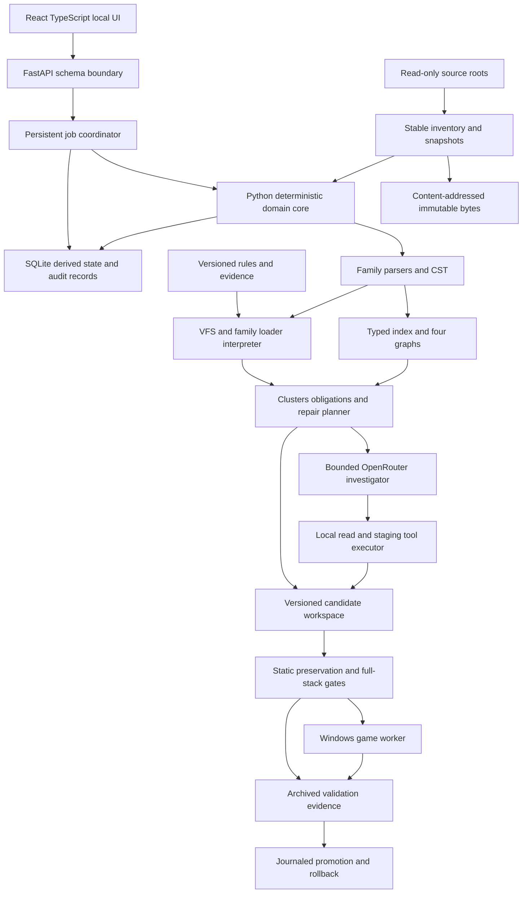

# Architecture and implementation contracts

Revision 2.0 — 26 October 2026. **P — proposed architecture throughout**, except explicitly attributed API facts. Governed by [SPEC.md](SPEC.md); loader rules live in [EU5_LOADING_SEMANTICS.md](EU5_LOADING_SEMANTICS.md), not in generic service code.

## 1. Local deployment boundary

The Windows application runs a Python/FastAPI service, SQLite and managed blob/workspace directories for one user. React/TypeScript is served locally by that service. Bind to loopback by default; require a per-installation session capability and origin checks for mutating browser requests. Expose no unauthenticated LAN service. Secrets stay in backend/OS credential storage, outside browser state, mod files, prompts and replay fixtures.

macOS runs the same domain core against synthetic or imported snapshots. Game execution and live Windows discovery use a replaceable Windows adapter. The normal deployment keeps UI, API, workers, game and storage in the VM; an optional development bridge may invoke a paired Windows worker using an authenticated bounded channel. The bridge is not required to implement macOS contract tests. It sends manifests and staged probes, not arbitrary shell commands or unrestricted paths.

OpenRouter inference is remote and optional per job; deterministic scanning and validation remain local. Configuration identifies the permitted providers/models, source-excerpt policy, budgets and fallback policy. The UI shows which snippets and metadata will be transmitted. Connection failure leaves findings and staged work intact.



## 2. Component responsibilities

| Component | Inputs and outputs | Boundary |
|---|---|---|
| Discovery adapters | Windows known folders, Steam libraries, selected playset, metadata, DLC, overlays → candidate manifests | Read-only until a persistence adapter is conformed |
| Snapshot store | Stable source bytes → immutable blobs, manifests and consistency status | Never index mutable live bytes as if frozen |
| Parser front ends | Byte blobs + dialect → CST, diagnostics, positions | Unknown syntax retained; semantic eligibility separate |
| Documentation importer | Installation script docs and data-type dumps → versioned vocabulary/schema | No global enum copied from a different game/build |
| Rule registry | Sources, contradictions, experiments → immutable scoped profiles | D/I/H cannot become C through configuration alone |
| Loader interpreter | Candidate manifest + profile → VFS, operations, effective values, unknown alternatives | Path selection, scheduling and readers remain separate |
| Semantic index | CST/IR + docs → typed symbols/references and behavior approximations | Literal, expanded, dynamic and unknown edges remain distinct |
| Conflict planner | Full-stack provenance + intent baselines → clusters, obligations, candidate plans | A selected winner does not satisfy lost intent |
| Agent executor | Bounded cluster context + validated calls → investigation and staged proposals | No source writes, arbitrary execution or design waivers |
| Validation coordinator | Complete candidate stack → gate results and required probes | Required unknown/not-run blocks validated promotion |
| Windows worker | Approved probe recipe + manifests → milestones, logs and observations | Isolated disposable profile; active stack verified each run |
| Promotion manager | Valid immutable candidate + preconditions → managed release, journal, rollback | Game/playset closed when required; sources untouched |

No component may implement its own fallback rule such as “last key wins.” Rules are explicit dependencies that contribute evidence IDs to all affected results.

## 3. Repository and managed-data layout

Illustrative implementation layout:

```text
backend/
  app/api/                  # FastAPI routes and schemas
  core/{snapshots,parsing,semantics,loading,planning,validation}/
  adapters/{windows,playsets,openrouter,script_docs}/
  workers/
frontend/src/{screens,components,api}/
schemas/                    # shared transport and fixture contracts
profiles/{synthetic,documented,conformed}/
tests/{contract,property,integration,agent_replays,conformance}/
docs/                       # this specification package

<managed-workspace>/
  workspace.sqlite3
  blobs/sha256/<prefix>/<hash>
  snapshots/<snapshot-id>/manifest.json
  profiles/<profile-content-hash>.json
  jobs/<job-id>/
  staging/<candidate-id>/
  releases/<release-id>/
  evidence/<validation-run-id>/
  journals/<promotion-id>.json
  active-release.json
```

The application discovers an appropriate local writable data directory instead of using the installation or Workshop root for state. Source roots and managed roots must not overlap. Walkers do not follow symlinks, reparse points or junctions outside an authorized root; copy/import operations reject traversal, absolute archive entries and Windows device-name/path alias hazards. Source identifiers are opaque database IDs, never client-supplied filesystem authority.

## 4. Immutable data and SQLite model

SQLite is the local coordination and query store; content-addressed blobs are the byte authority. Use foreign keys, migrations, bounded writer transactions and a single coordinated writer. WAL may be used on a supported local filesystem. Do not place a live SQLite database on a shared VM/network folder without an explicit tested storage policy. Backups use a consistent SQLite backup mechanism plus referenced blob manifests. Derived indexes are disposable and rebuildable; originals, decisions and evidence are retained.

All derived records include `snapshot_id`, `profile_hash`, `parser_version`, `schema_hash` and relevant documentation fingerprint. Publish a scan only when a complete consistent derived generation commits; UI queries pin that generation. Do not mix findings from one profile with effective definitions from another.

| Record | Essential fields |
|---|---|
| `workspace` / `target` | selected roots, fixture/game mode, branch/version, exe/content/docs hashes, DLC manifests, environment fingerprint |
| `scan_snapshot` | ordered enabled package IDs, playset provenance/hash, candidate manifest hash, consistency/completion state |
| `package` / `package_dependency` | metadata ID, Workshop ID, version raw text, path/source, relationships, enabled state and actual ordinal |
| `file_blob` / `virtual_file_candidate` | raw hash, size, path spellings, Windows key, stage, family, source package, mask/shadow links |
| `parse_document` / `occurrence` | blob and dialect, token/CST cache location, byte spans, raw key, occurrence ordinal, diagnostics |
| `symbol` / `reference` | scoped typed identity, visibility, occurrence, certainty, target candidates, unresolved reason |
| `definition_operation` | mode or bare-create, input body, source ordinal, VFS/family order, rule/evidence dependencies |
| `effective_definition` / `transition` | ordered body, typed reader result, suppressed contributions, unknown alternatives and explanation edges |
| `rule` / `rule_evidence` / `experiment` | immutable rule version/scope/status, source revision or archived experiment, contradictions and invalidation keys |
| `intent_obligation` / `baseline` | exact upstream base or unknown, expected delta/predicate, observability, satisfied/violated/unknown/waived state |
| `finding` / `conflict_cluster` | category, certainty, impact, graph members, coverage, repairability and supporting occurrences |
| `repair_plan` / `candidate` | exact read/write sets, edits, rationale, prerequisites, expected effective/preservation deltas |
| `design_decision` | alternatives and selected predicates/waivers, actor/time, input/profile/candidate hashes |
| `validation_run` / `gate_result` | required/optional gate, outcome, target manifests, observation artifacts and comparison baseline |
| `promotion` / `audit_event` | journal states, expected/previous/new hashes, recovery actions, immutable event details |

Store parser trees externally or in a versioned compact cache when appropriate; do not duplicate every original byte in SQLite. Cache keys include content, parser/dialect, schema and semantic profile dependencies. A semantic or effective hash is not interchangeable with the raw-byte hash.

## 5. Identity, graphs and effective state

File identity retains `(source, original_relative_path)`. VFS identity uses stage-aware paths under the selected path rule. Definition identity retains `(resource_stage, loader_family, namespace, definition_id)` until a measured rule proves a different cross-stage namespace. GUI types/templates/widgets, event namespaces and localization language/key identities need family adapters.

Maintain four related graphs:

1. **Package graph:** requirements, versions, enabled state, DLC and ordering constraints.
2. **Definition graph:** typed references, helper visibility, GUI bindings, localization and assets.
3. **Operation graph:** create/inject/replace, target dependencies, shadows and path masks.
4. **Behavior graph:** calls, callback subscriptions, scope transitions, variable reads/writes and declared observations.

Edges carry certainty, source span and rule/evidence IDs. Unknown dynamic targets do not become false missing-reference errors, and absence of incoming edges is not proof that a definition is unused. Hardcoded engine entry points remain possible.

Represent field results as a tagged union: `Known(value, evidence_dependencies)`, `Unknown(reason, candidates, dependencies)`, `Invalid(diagnostics)`. Ordered source bodies and discarded occurrences remain accessible even when a typed reader produces one scalar. Unknowns propagate through affected dependencies without blocking independent known regions.

## 6. Service contracts

Pydantic or equivalent strict Python schemas define API payloads, generated OpenAPI and TypeScript types. Validate at the server even when the client or model supplies typed JSON. Use opaque IDs for snapshots/plans; filesystem paths are returned for display only. Paginate large graphs and provide bounded source spans, not full-installation blobs by default.

Proposed minimum API:

| Endpoint | Contract |
|---|---|
| `POST /api/workspaces` | Configure fixture or game inputs and source policy |
| `POST /api/workspaces/{id}/scans` | Start stable inventory and analysis with explicit profile hash |
| `GET /api/jobs/{id}` and `/events` | Persistent state + resumable SSE progress using event IDs |
| `GET /api/scans/{id}/findings` | Filtered clusters with coverage/evidence summaries |
| `GET /api/scans/{id}/definitions/{key}` | Effective value, transitions, hidden source candidates and references |
| `GET /api/evidence/{id}` | Source revision/experiment, scope, contradictions and artifacts |
| `POST /api/clusters/{id}/investigations` | Budgeted deterministic/agent investigation pinned to snapshot |
| `POST /api/plans/{id}/decisions` | Concrete selected alternative and exact decision preconditions |
| `POST /api/plans/{id}/stage` | Guarded structural edits into a new candidate only |
| `POST /api/candidates/{id}/validate` | Full-stack required gate plan, optionally controlled runtime probes |
| `POST /api/candidates/{id}/export` | Export immutable experimental bundle or promote validated managed release; explicit result type |
| `POST /api/releases/{id}/rollback` | Preview then apply restoration with intervening-edit checks |
| `GET /api/workspaces/{id}/coverage` | Family/build support, opaque regions and outstanding conformance |

Mutating requests include an idempotency key and expected snapshot/candidate revision. Stale preconditions return `409` with changed identities and a reanalysis path. Invalid schema returns a structured validation error; blocked gates return reasons, not a generic success. Export kinds `experimental_bundle` and `validated_managed_release` have distinct eligibility and UI labels. An experimental bundle is a portable review/probe artifact only: it cannot change an active-release pointer or write/activate a playset. It preserves unknown/not-run gate states and all path, snapshot and edit-precondition safeguards. Synthetic workspaces cannot target real playsets. Gate requiredness derives from deterministic policy and the complete affected obligation closure, never from a model-selected subset.

A finding payload includes `category`, `impact`, `certainty`, `coverage`, `source_occurrences`, `lost_obligation_ids`, `evidence_ids`, `runtime_requirements`, `repairability` and `cluster_id`. Gate outcomes are exactly `pass`, `fail`, `unknown`, `not_run`, `not_applicable`; `required` is separate.

## 7. Jobs, cancellation and invalidation

Persist jobs as `queued → running → completed | failed | cancelled | awaiting_user`. Candidates use `draft → staged → validating → ready | blocked | stale`, then a separate export/promotion record. “Blocked” in this product means a specific failed prerequisite or pending design choice, and must display its reason. User input can resume the relevant cluster without rerunning unrelated work.

Long scans, parsing and game launches run outside request handlers. A single Windows worker owns the game process and target test profile; concurrent launches and playset writers are prohibited. Cancellation is cooperative at safe boundaries, terminates owned probe processes when necessary, archives incomplete evidence, and never promotes partial output.

Every plan records complete read/write sets and reverse dependencies. Changes to mod bytes, actual enabled order, selected baseline, executable/content/DLC/docs, profile, schema, parser or approved intent invalidate applicable results. Revalidate narrowly where dependency tracking proves independence; otherwise mark stale. Source display versions and timestamps are hints, not sufficient cache keys.

## 8. OpenRouter agent contract

**API fact:** client tools are requested by the model and executed by the application, with tool-call IDs used to return results. Model/endpoint tool support must be checked. [OpenRouter client tools](https://openrouter.ai/docs/guides/features/tool-calling).

**API fact:** structured-output support varies by provider endpoint. Request the required parameters and validate every completed response locally; never treat schema-shaped JSON as proof of semantic validity. [Structured outputs](https://openrouter.ai/docs/guides/features/structured-outputs).

Expose only bounded tools: `search_sources`, `read_spans`, `show_definition_history`, `get_effective_definition`, `find_references`, `inspect_rule_evidence`, `propose_structural_edit`, `validate_candidate`, `run_game_probe`. Calls use explicit snapshot IDs and allowed roots/scopes. Read-only calls can execute concurrently; overlapping mutations and game probes serialize. Tool results are data, never instructions that override app policy.

The model investigates a cluster and its dependency closure. It cannot mutate original mods, run arbitrary commands, invent evidence, waive obligations, change the active playset directly, or choose a design sacrifice. A probe call selects an allowlisted recipe; the worker materializes and checks its inputs. Budgets bound tokens, requests, elapsed investigation time, source bytes, tool calls and game launches.

Require proposals with exact structural operations, expected source hashes, read/write sets, evidence IDs, rationale, expected results, preserved obligations, known unknowns and requested decisions. Reject unsupported operations and overlapping/unbounded edits. Apply valid proposals in memory/staging, run local validators, and return precise gate failures for revision. Do not execute streamed partial JSON or retry an ambiguous mutation without an idempotency check.

Cache request/response and tool transcripts using cluster/baseline/rule/prompt/tool-schema/model/provider fingerprints; redact credentials. Replays are deterministic tests of the local orchestration, not promises of deterministic remote inference. Offline mocks and provider failures must exercise the same gates.

## 9. Staging, promotion and crash recovery

1. Freeze candidate inputs and create a new versioned managed output directory.
2. Apply edits using document hash + byte-range preconditions. Verify every unchanged byte region and every output path.
3. Simulate the entire final playset and run all required gates. Store immutable reports and output hashes.
4. Record intended release and previous managed state in a write-ahead journal. Acquire managed-target and playset locks before final precondition checks and retain them through activation and verification. Recheck live sources, profile, decisions, managed target and playset state while holding those locks.
5. Promote the managed directory/pointer using the platform's tested mechanism. If playset persistence is not conformed, export the concrete plan for application through the game's UI; do not claim it was installed.
6. Verify the promoted state and recheck externally mutable source hashes before declaring success; journal completion. An external source change during activation marks the release stale, prohibits a validated-success result, and triggers safe journaled restoration or explicit recovery if intervening edits prevent restoration. On restart, inspect incomplete journals and complete or restore the prior known state with hash checks.
7. Roll back through a new audited transaction, preserving evidence and checking external modifications.

Journal states distinguish `prepared`, `validated`, `promotion_started`, `files_active`, `playset_applied`, `verified`, `rolled_back`, and `recovery_required`. Platform adapters must define recovery for every transition, including a pointer switch without a successful playset write. “Atomic promotion” cannot mean a loop of independent file renames.

## 10. Windows runtime worker and deployment

Package the same tested backend and frontend for local Windows use with pinned dependency lockfiles. Provide one startup flow, schema migration/backups, health/status view and a reversible application update procedure. Do not require a cloud database or an internet connection for analysis. Store writable runtime state separately from packaged code.

Before committing to the VM, verify its CPU architecture, graphics and game environment by actually initializing the selected EU5 installation. Record failure as infrastructure evidence, not a mod failure. Keep the runtime worker transport replaceable so an approved compatible Windows host can run the identical manifests if necessary.

The worker captures executable/content/docs/DLC hashes, settings, actual playset order, test user profile, mod versions and bytes, run commands, milestones, logs, direct observations and restoration status. It materializes probes from private valid installation seeds. Game/Workshop content is not embedded in public fixtures.

Run cold-start baseline, individual mods, original stack and repaired stack. Verify active mods after crashes because the game may rewrite/disable state. Archive raw logs before normalization; compare stage and occurrence counts against baseline and single-mod runs. Menu reachability alone does not cover `in_game` resources or behavior. Runtime recipes require direct discriminating observations, negative controls and declared stopping conditions. See [TESTING.md](TESTING.md) and [RESEARCH_GAPS.md](RESEARCH_GAPS.md).

## 11. Observability and performance

Show truthful progress by phase and completed units, not invented total percentages. Preserve structured job errors, source-hash changes, worker availability and missing evidence. Redact secrets and allow source excerpts to be excluded from diagnostic export.

Cache whole-file parsing first; incrementally reindex changed documents and reverse dependencies. Benchmark on a declared corpus with file/byte counts, host/VM resources, cold/warm runs, peak memory and phase timings before setting performance release targets. Do not sacrifice byte preservation or introduce host-dependent ordering for speed. Large scans must remain cancellable and the UI responsive through pagination and progress events.
