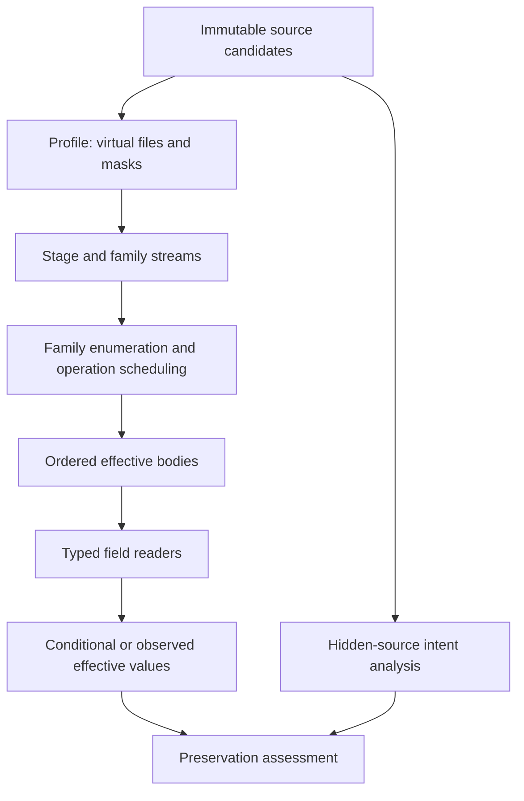

# EU5 loading semantics and rule profiles

Revision: 2026-10-26. This document defines proposed application requirements (**P**) and records the evidence used to implement them. It does not certify any EU5 executable. Read with [SPEC.md](SPEC.md), [EU5_SCRIPTING.md](EU5_SCRIPTING.md), [RESEARCH_GAPS.md](RESEARCH_GAPS.md), and [TESTING.md](TESTING.md).

## Evidence boundary

The supplied [research report](RESEARCH_REPORT.md), §§1, 4–5, 8 and 10, is the source baseline. Its cutoff is 26 October 2026. **V** means a fact about an inspected source/repository, **D** documented game behavior, **I** inference, **H** unresolved behavior, and **P** proposed design. **C** is reserved here for a subsequently executed, archived, build-scoped conformance result. There are **no C loading rules in this package**. A wiki statement is D even when the report verified that the page contains it; it is not an executable observation. Source links below identify the report's evidence; publication of this package does not re-verify those pages.

The report identified stable 1.3.11 and beta 1.4.4 as distinct research targets. These are historical target labels, not a claim that either is the current installed version. A profile must capture the actual installation, branch and executable/content hashes. Do not extrapolate beta results to stable, or vice versa. [Report version sources](RESEARCH_REPORT.md)

## Required separation of identities and phases (P)

Three questions must remain independently inspectable: what syntax exists, which resources/definitions the game is predicted to load, and whether the resulting gameplay preserves each mod's objectives. A successful parser does not answer the latter two.

The physical resource stages are `loading_screen`, `main_menu`, and `in_game` (**D**). A mod root corresponds to vanilla `game/`; a nested `game/` inside a mod is not the documented layout. `.metadata/metadata.json` describes the mod. The stages must be retained in every physical path and provenance record. [EU5 mod structure](https://eu5.paradoxwikis.com/Mod_structure)

The application shall use these explicit identities:

| Identity | Required distinction |
|---|---|
| Package | Metadata ID, Workshop item ID, source path and package snapshot hash are separate fields. |
| Physical file | Source package plus original relative path; retain the stage prefix and source spelling. |
| Virtual resource | A profile-defined Windows comparison key; do not use macOS path behavior as the game contract. |
| Definition | Stage/flow namespace, family, type-specific identity, definition ID and visibility domain. |
| Source occurrence | Document snapshot, byte span and ordinal; repeated keys/operations remain separate. |
| Effective contribution | Source occurrence plus operation/reader transition and applied rule/evidence IDs. |

Stage-specific names are not automatically aliases. The community inventory reports some `main_menu/common` and `in_game/common` scripted databases as separate (**V**, author observation); exact sharing and visibility remain **H** until E18. [Pinned inventory](https://github.com/BerFoe/eu5-modding-skill/blob/3b7e8f930303abc949c77f3d5c9b741ee896e620/eu5-modding/references/mod-structure.md)

The simulator shall perform the following application phases. They are a decomposition, not a new assertion of executable implementation order:

1. Pin package identities, enabled playset, order, base game, DLC and user overlays.
2. Inventory every source candidate and immutable byte blob.
3. Resolve exact-path shadows and `replace_paths` masks according to the selected profile. Keep all losing candidates.
4. Partition surviving files by resource stage and loader family; enumerate using that family's rule.
5. Parse/extract definitions and operation records from effective files. Index hidden source files separately for intent recovery.
6. Schedule registration and operations using the family's profile; keep failed, ignored and erased transitions.
7. Interpret ordered effective bodies with typed field readers.
8. Resolve typed/dynamic references, assess preservation obligations, and report uncertainty and coverage.



Only surviving files participate in active-loader prediction. The application must nevertheless explain what an entire-file shadow concealed, including unrelated definitions lost with that file. Never apply “all of mod A, then all of mod B” as a universal object-loader algorithm.

## Documented loading rules and production restrictions

The compatibility wiki documents lower playlist entries winning identical relative paths; subsequent ASCII filename enumeration with parent files before descendants; and the six-mode batch sequence below (**D**). It also documents injection as top-level script append, not recursive merge. Its supported-folder inventory is incomplete, and its material includes a 1.1-era verification boundary. These statements may support **conditional prediction** in a documentation profile; every production family must still pass the relevant Windows probes. [Compatibility documentation](https://eu5.paradoxwikis.com/Mod_compatibility)

```text
INJECT_OR_CREATE → REPLACE_OR_CREATE → TRY_INJECT → TRY_REPLACE → INJECT → REPLACE
```

The synthetic `synthetic-contract-v1` in [TESTING.md](TESTING.md) deliberately defines bare-create-first, reject-second duplicate creation, and explicit traversal/order behavior to test the interpreter. Those are fixture-contract choices, not measured game facts. Production profiles must establish their own E05/E06 results.

The six-mode sequence does not specify bare-definition registration completely. A profile must separately represent bare creation, duplicate creation, within-file ordinal, same-mode ordering, errors, and failure scope. It shall not silently insert a universal `create` phase before the six modes. ASCII ordering does not determine non-ASCII names or Windows case/Unicode aliases. `replace_paths` masking versus overlay order is likewise profile-controlled rather than guessed.

## Six database operations

The official release modding diary introduces these modes for many database objects, excluding setup and on-actions at release (**D**). The available family set and exact failure effects must be checked for each selected build. [Official Tinto Talks #85](https://forum.paradoxplaza.com/forum/developer-diary/tinto-talks-85-22nd-of-october-modding.1864004/)

| Prefix | Documented existing-target action (D) | Documented absent-target class (D) | Required unresolved detail (H) |
|---|---|---|---|
| `INJECT:id` | Append script | Error | Does the error abort an object, file, family or load? |
| `REPLACE:id` | Replace body | Error | Same failure-scope question. |
| `TRY_INJECT:id` | Append script | Tolerated | Confirm no-op details and diagnostic behavior. |
| `TRY_REPLACE:id` | Replace body | Tolerated | Confirm no-op details and diagnostic behavior. |
| `INJECT_OR_CREATE:id` | Append script | Create | Creation and duplicate interaction within schedule. |
| `REPLACE_OR_CREATE:id` | Replace body | Create | Creation and duplicate interaction within schedule. |

A bare `id = { ... }` is a distinct creation record, not a seventh prefixed mode. A duplicate bare definition must not default to last-wins. A public mod's notes report rejected later duplicates (**V**, community observation); E06 must measure the relevant family/build. [Towards Victory notes](https://github.com/HLJSXK/eu5-towards-victory/blob/main/docs/technical/EU5_Modding_Knowledge_Base.md)

Extract a prefix only from an eligible top-level declaration in a mode-enabled family. Preserve `raw_key` alongside `definition_id` and `mode`. A colon in `scope:name`, `country:...`, quoted text, or an unsupported/nested statement must not become an engine operation. The semantic IR shall record:

```text
OperationRecord {
  snapshot_id, stage, family, visibility_domain,
  definition_id, raw_key, mode, body_node,
  package_id, relative_path, ordinal_in_file, source_byte_span,
  vfs_rank, enumeration_rank, profile_revision, evidence_ids
}
```

A generated patch must be simulated with the **whole stack**. A later `zz_` filename cannot make an injection survive a later operation class that replaces the body. The engine must show which operation erases which contribution and whether a different expressible operation can preserve the obligations.

## Operation scheduling is distinct from field reading

An injection may append a second `price`, `modifier`, or trigger block without establishing that the game's reader consumes both. The effective body and its interpreted values shall be stored separately. A surviving source node is not sufficient proof of preserved functionality.

The compatibility page says appended trigger/effect subblocks may be rejected, and injection into scripted effects/triggers acts as replacement (**D**). This is a family exception to generic append behavior, requiring E09/E10. The Standard of Living project's notes report additive static-modifier numbers and replacement behavior for repeated price resource fields (**V**, author observation). Neither “all numeric values add” nor “all scalars replace” is justified. [Compatibility page](https://eu5.paradoxwikis.com/Mod_compatibility), [SOL implementation notes](https://github.com/HLJSXK/eu5-modding-project/blob/main/docs/knowledge/BRIEF.md)

Proposed reader policy names include `scalar_first`, `scalar_last`, `numeric_sum`, `append_occurrences`, `unique_set`, `ordered_commands`, `single_block_only`, `named_members`, and `unknown`. These are application concepts (**P**), not game keywords. Each policy requires a family and field selector, target scope, evidence, multiplicity/idempotence rule, conformance case, and diagnostic behavior. Numeric type alone must never choose the policy. Use exact decimal representations or a confirmed fixed-point model; never rewrite with binary floating-point formatting.

Do not deduplicate identical injections automatically: applying an operation twice may intentionally double an effect. Do not infer that a change from 10 to 12 expresses “add 2”; the author may intend an absolute target, threshold or balance choice. Author baseline evidence and preservation obligations are required.

## Family adapters and known exceptions

| Family | Evidence baseline | Required adapter and gate (P) |
|---|---|---|
| Mode-enabled databases | Six mode meanings are D; complete family coverage is H. | Explicit supported path/family list; separate bare registration, schedule and readers. Unknown families remain opaque or symbolic. |
| Defines | Later-loaded duplicate define wins; static/global categories are documented; page marked 1.3. [Defines](https://eu5.paradoxwikis.com/Defines) | Identity `(category, define_name)`; inspect installed names/types; verify file order per build. |
| Events | Earlier duplicate event-ID selection and earlier-file individual override are D; event guide includes pre-release material. [Event guide](https://eu5.paradoxwikis.com/Event_modding) | Namespace-qualified IDs, file-local helper closure, firing references and exact duplicate diagnostics. Event override export blocked pending E12/E13 because source claims disagree. |
| On-actions | Dedicated guide recommends unique callback registration through `on_actions`; wider additive claims differ. [On-action guide](https://eu5.paradoxwikis.com/On_action) | Keep hook definition, callback registration and callback body distinct. No generalized trigger/effect/events merge. Gate composition on E14; detect duplicate execution and cycles. |
| Localization | Reverse filename processing and `language/replace/` priority are D; page includes 1.0-era material. [Localization](https://eu5.paradoxwikis.com/Localization) | Dedicated parser/loader; identity includes language/key/occurrence/tier. Retain header, revision, quoting and BOM. E15 measures each tie independently. |
| GUI | Type/template playlist precedence independent of filenames is D in compatibility guide. [Compatibility](https://eu5.paradoxwikis.com/Mod_compatibility) | Separate exact-file shadows, type/template identity, top-level widget `name`, inheritance, constants and binding references. E16 before composition. |
| Setup | Excluded from modes at release; manager-specific additive behavior and initialization dependencies are D. [Setup guide](https://eu5.paradoxwikis.com/Setup_modding) | Partition by manager and initialization phase. Filename identity for template `include`; E20/E21 before output. |
| Tables/map content | Formats and loader algebra vary; exhaustive coverage H. | Inspect actual handler; do not apply script/CST or database rules by extension alone. |
| Binary/unknown assets | Payload equality is byte-verifiable; semantic merging unknown without adapter. | Hash/reference analysis; preserve opaque bytes. Unequal payloads need asset-specific implementation or a user design choice. |

Setup documentation distinguishes UTF-8 BOM for `setup/countries` and `setup/templates` from no BOM for `setup/start` (**D**). Therefore a global BOM writer is prohibited. Localization is a Paradox-specific format; ordinary YAML serialization is not a safe default. [Setup documentation](https://eu5.paradoxwikis.com/Setup_modding), [Localization documentation](https://eu5.paradoxwikis.com/Localization)

## Playset and source discovery

Defaults documented for Windows include Documents-based local mods and Steam Workshop application `3450310` (**D**). The application shall resolve the Windows Documents known folder, all Steam libraries and redirected paths, rather than assemble a guessed `C:\Users` path. Inventory local mods, Workshop, base content, enabled installed DLC and user overlays separately. [Mod documentation](https://eu5.paradoxwikis.com/Mod)

The pinned EU5 launch-helper reads `playsets.json`, `playsets[]`, `orderedListMods[]`, `path` and `isEnabled`; its author reports testing 1.3.11 and warns that an `isEnabled:false` entry did not exclude a mod (**V**, source/author observation). Another generic launcher maps EU5 to `content_load.json` while documenting checks on CK3 (**V**, contradictory weaker evidence). Neither claim is a universal persistence contract. [EU5-specific helper](https://github.com/BerFoe/eu5-modding-skill/blob/3b7e8f930303abc949c77f3d5c9b741ee896e620/eu5-modding/scripts/Start-EU5.ps1), [generic launcher](https://github.com/Adromedary/Adromedary-s-Paradoxical-Launcher/blob/1181389419caa9c3720eaf10f6d3bd5574c9916b/launcher.py)

Implement read-only playset adapters first. Before export, snapshot a disposable user profile with the game closed, create A/B through the UI, Apply/exit, reverse order, disable B and change active playset as independent changes. Compare filenames/hashes and changed JSON/SQLite schemas; prove actual active content with a sentinel, rather than mounted availability. Preserve unknown fields and unrelated DLC/UI state. Until a write adapter is proven, deployment uses the in-game UI for activation.

## Versioned rule profile contract (P)

Profiles are immutable, content-hashed records. A profile revision shall pin:

- Game version, branch, executable hash, Steam/content identifiers where available, installed content manifests, DLC set and relevant settings/user overlays.
- Installation inventory, script-documentation and data-type dump hashes; parser/schema revisions.
- Explicit stage/family/path selectors; path comparison, case and Unicode policy; exact-file precedence; mask scope/order; file enumeration.
- Definition identity/visibility; bare registration and duplicate rules; operation schedule, within-mode/within-file order and failure scope; field readers and reference rules.
- Each rule's source URL/revision/date, evidence label, conflicts, experiment IDs/artifact hashes, tested scope, unknowns and invalidation dependencies.
- Declared coverage and allowed capabilities: analysis, conditional simulation, staged repair, production export.

Illustrative profile fragment; **not a production default**, and `null` values are deliberately unresolved:

```json
{
  "profile_id": "eu5-docs-cutoff-2026-10-26",
  "profile_revision": 1,
  "profile_kind": "documentation_only",
  "target": {
    "version": null,
    "branch": null,
    "exe_sha256": null,
    "content_manifest_hash": null,
    "dlc_manifest_hash": null,
    "script_docs_hash": null
  },
  "production_export_enabled": false,
  "rules": [{
    "id": "six-mode-batch-order",
    "evidence_label": "D",
    "status": "documented_unconfirmed_on_build",
    "applies_to": {"stages": [], "families": [], "path_globs": []},
    "semantics": {
      "prefixed_mode_order": [
        "INJECT_OR_CREATE", "REPLACE_OR_CREATE", "TRY_INJECT",
        "TRY_REPLACE", "INJECT", "REPLACE"
      ],
      "bare_registration": null,
      "within_mode": null,
      "failure_scope": null
    },
    "evidence": [{
      "label": "D",
      "url": "https://eu5.paradoxwikis.com/Mod_compatibility",
      "reported_access_date": "2026-10-26"
    }],
    "conformance_artifacts": [],
    "unknowns": ["family coverage", "bare registration", "batch scope"]
  }]
}
```

Empty selectors mean **no production applicability**, never wildcard applicability. A documentation profile may render a conditional scenario only after an explicit family selection and shall show that its assumptions remain unconfirmed. Schema validation must reject production-enabled rules lacking exact scope and required conformance artifacts. Rule confidence cannot be increased by an LLM response or user preference. User approval can settle a design objective, not turn an unknown loader rule into a measured fact.

Promotion requires the E-series experiment protocol in [RESEARCH_GAPS.md](RESEARCH_GAPS.md). A C rule may be used only within its tested selector/build constraints; every dependent repair must retain the rule hash. Changes in executable, relevant content/DLC/docs, parser, profile or design assumptions invalidate affected caches and plans. Contradictory observations quarantine the rule and all dependent automatic exports. Preserve superseded evidence for audit.

## Unknowns, findings and result wording (P)

Use symbolic values such as `UnknownValue(reason, operations, candidate_values, dependent_rule_ids)` where behavior is unresolved. Keep uncertainty local: an unknown GUI rule need not prevent analysis of an independent, confirmed define. Bound alternative exploration; never pick the host filesystem order as a hidden fallback.

Every result must distinguish:

- **Predicted loader result:** which content survives under named rules, with evidence and confidence.
- **Preservation result:** which mod obligations survive, are lost, remain unproven, or were explicitly waived through a design decision.
- **Validation coverage:** static checks and runtime milestones actually performed; unsupported files/families and outstanding probes.

Findings use the five categories `confirmed_incompatibility`, `potential_incompatibility`, `compatible_overlap`, `load_order_dependent`, and `semantic_gameplay_conflict`. Record certainty, runtime impact, lost intents, order sensitivity, repairability and coverage independently. A definite static parse error is different evidence from an observed engine failure. A predictable winning mod can still erase another mod's intent.

Build conflict components across files, definitions, operations, callbacks, assets, references and preservation obligations. Pairwise comparisons are insufficient for A+B+C interactions and generated patches. No automatic repair is acceptable merely because it parses, produces an effective scalar, or starts the game. The post-patch full-stack interpretation and required preservation/validation gates must pass.
