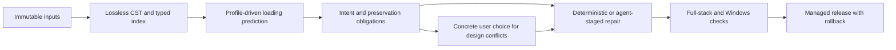

# EU5 Mod Compatibility Engine — documentation index

**Revision 2.0 · 26 October 2026 · proposed implementation contract**

This package updates the design around a lossless editor, an evidence-driven loading simulator and preservation-based repair gates. It retains the local solo-use app, Python/FastAPI, React/TypeScript, SQLite, OpenRouter investigation agent, macOS fixture development, Windows VM deployment/game checks, user control over design conflicts, validation and rollback.

Start with [SPEC.md](SPEC.md). For what changed and what could not be compared to the earlier draft, read [CHANGE_SUMMARY.md](CHANGE_SUMMARY.md). The previous chat's specification body was not recoverable: its assistant messages were content-reference placeholders. This is a reconstructed revision using the user's explicit requirements and the recovered report, not a verified line-by-line edit of an accessible original.

## Reading map

| File | Purpose |
|---|---|
| [SPEC.md](SPEC.md) | Scope, requirements R01–R15, user workflow, preservation, design decisions, release gates |
| [ARCHITECTURE.md](ARCHITECTURE.md) | Local service boundaries, workers, SQLite model, API contracts, agent tools, state and transactions |
| [EU5_SCRIPTING.md](EU5_SCRIPTING.md) | Script families, byte-oriented lossless CST, ordered occurrences, semantic IR, scopes and guarded edits |
| [EU5_LOADING_SEMANTICS.md](EU5_LOADING_SEMANTICS.md) | Three resource stages, VFS versus database loading, six modes, field readers and versioned profiles |
| [RESEARCH_GAPS.md](RESEARCH_GAPS.md) | Disagreements, unknowns, E01–E25 proposed experiments and rule-promotion criteria |
| [TESTING.md](TESTING.md) | Twenty initial fixture families, macOS/Windows matrix, agent replays, actual-game checks and rollback |
| [AGENTS.md](AGENTS.md) | Implementation instructions and non-negotiable evidence/preservation boundaries |
| [WIREFRAMES.md](WIREFRAMES.md) | Five frontend mockups and interaction/accessibility requirements |
| [SOURCES.md](SOURCES.md) | Source provenance, confidence boundaries and citation map |
| [RESEARCH_REPORT.md](RESEARCH_REPORT.md) | Supplied research report, with only its two companion-file links made portable |
| [Fixture guide](fixtures/README.md) | Illustrative schema and concrete disjoint-property fixture; no game-validity claim |

[INDEX.md](INDEX.md) is a short alternate entry point. `MANIFEST.json` lists packaged file hashes; `PACKAGE_CHECKS.md` records documentation checks actually performed. Neither is a game-validation report.

## Evidence labels

- **V** — inspected source/repository fact; verifies that source, not the executable.
- **D** — documented game behavior, retaining age and caveats.
- **C** — executed and archived build-scoped conformance observation. **None is newly supplied here.**
- **I** — inference; **H** — hypothesis/unknown; **P** — proposed application design or synthetic contract.

There was no EU5 runtime available to the report's investigation, and no game experiment was executed for this update. Documentation can support conditional predictions; production automatic repairs require the relevant build/family conformance and complete preservation gates. User design approval cannot turn an unknown loading rule into an observation.

## Quick orientation

All unmarked normative application requirements are **P**. Illustrative JSON, synthetic test fields and wireframe outcomes are not claims about accepted EU5 content. Historical stable/beta labels in the report are separate research targets at its cutoff; capture the actual installation before applying any profile.
