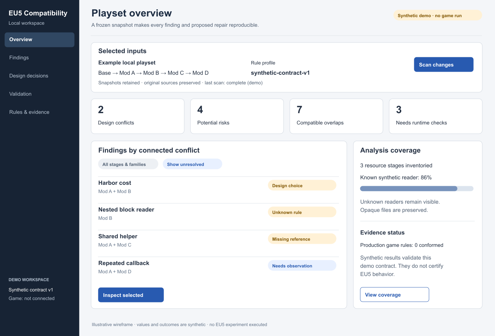
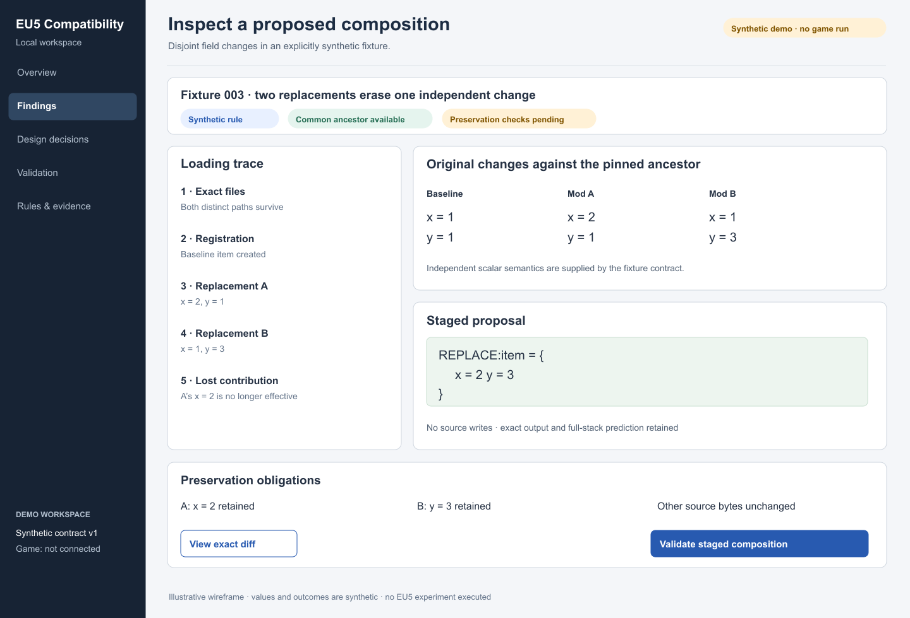
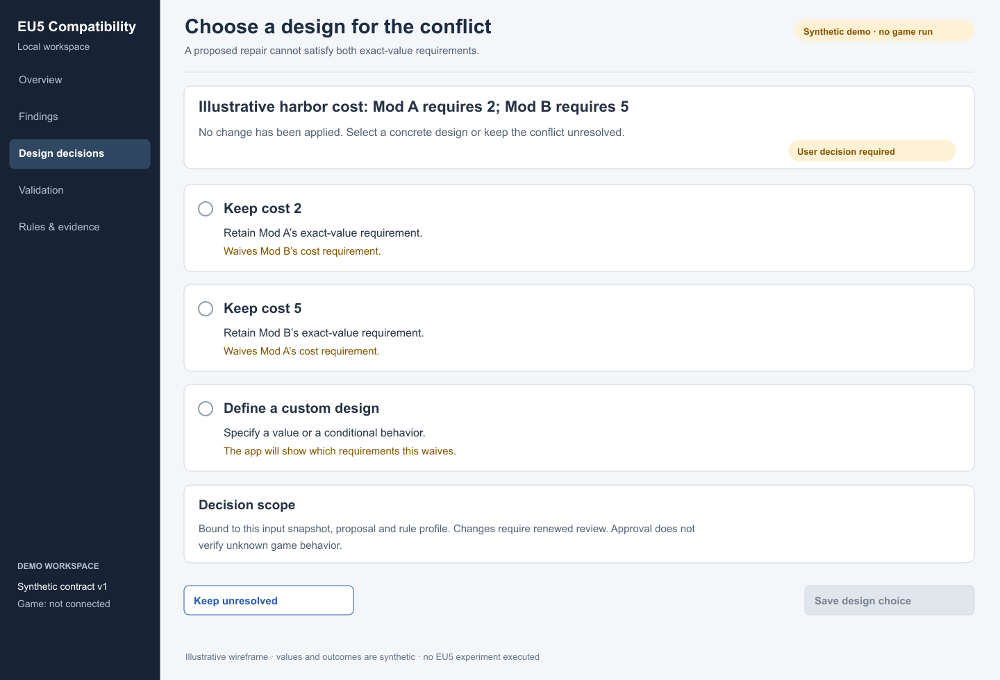
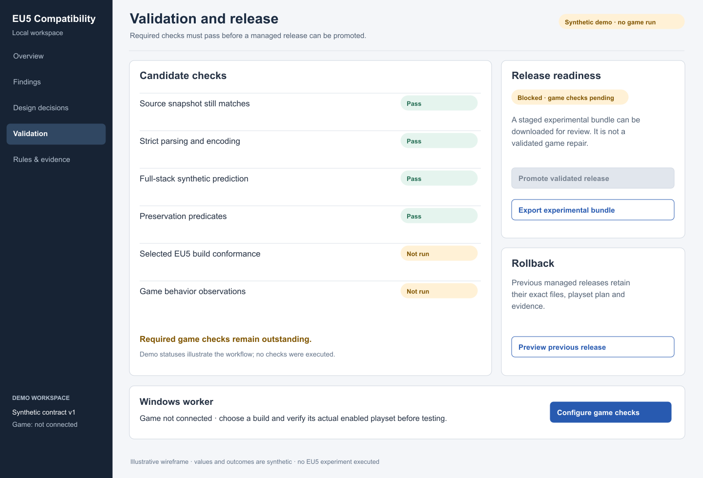
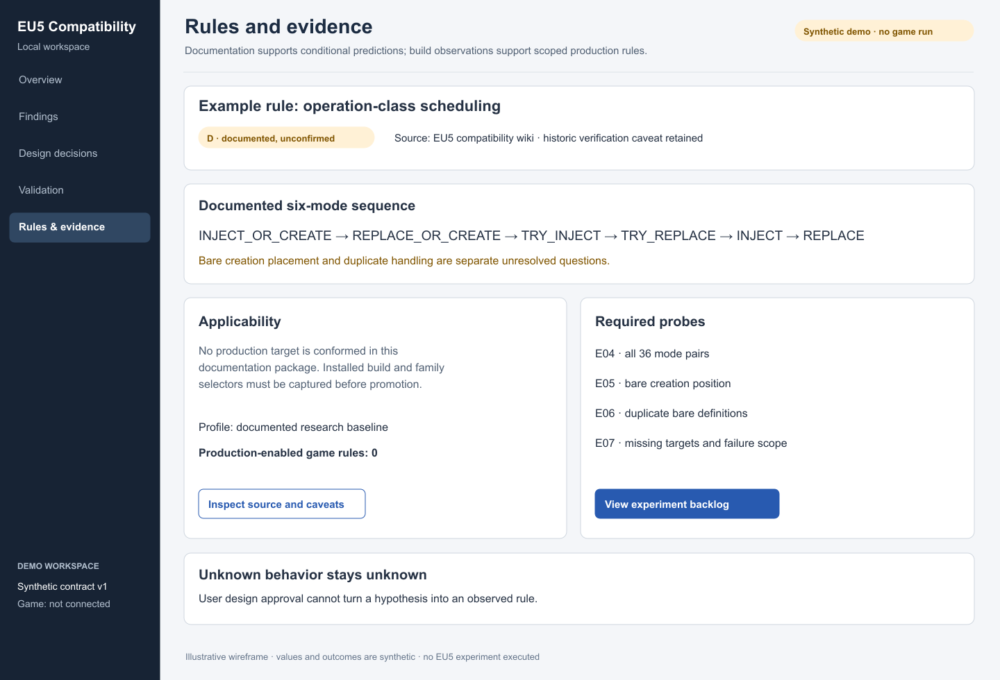

# Frontend wireframe mockups

**P — proposed React/TypeScript UI.** All displayed counts, source values and gate outcomes are synthetic demonstration data. These are static wireframes, not a running application, implemented tests or observed game results. PNG previews and editable SVG assets are included in `wireframes/` and are readable without external fonts or services.

## 1. Playset overview

Keep target identity, snapshot state and rule-profile status visible. Separate design conflicts, potential risks, compatible overlap and runtime checks. Coverage is independent of finding severity. Clicking a cluster opens its provenance and obligations. Filters must never hide unknown coverage from the workspace summary. A real workspace shows the captured installed build and branch; this demo deliberately shows a synthetic profile.

## 2. Investigation and staged composition

This is the included fixture 003: both mods replace one synthetic item, so the second replacement erases the first independent field change. Show the loading trace beside pinned-baseline deltas and the exact staged result. Retained source occurrences and discarded contributions remain navigable. The UI can show textual, structural and effective diffs as distinct views. A composition is automatically eligible only under established ancestry/independence, loader and reader prerequisites; no numeric field in this screen claims an actual EU5 goods schema.

## 3. Genuine design choice

Show the incompatible exact-value requirements and the requirement each alternative waives. The user may keep the conflict unresolved or specify a custom design. No lossy alternative is preselected. Saving binds the decision to the inputs, rule profile, proposal and waived obligations. Approving a choice does not verify a hypothesis or bypass validation. Keyboard focus and readable explanation must precede the confirmation control.

## 4. Validation, export and rollback

Each gate has a separate outcome and requiredness. Unknown and not-run are not pass. This demo disables promotion because game checks have not run, while offering an explicitly unvalidated portable experimental bundle. Experimental export never changes a playset or active-release pointer. A rollback preview shows precisely which managed files/playset changes will be restored, the previous hashes and any intervening edits before restoration proceeds.

## 5. Rules and evidence

Display source identity/revision, documentation caveat, build/family applicability, contradictions and experiment links. The six documented mode classes do not establish bare creation order. A profile with zero conformed production rules must say so. Follow any effective result to the exact decisive rule and its evidence; do not encode trust only as color.

## Required states and interactions

| Surface | States that must be designed and tested |
|---|---|
| Workspace | Unconfigured, synthetic, game configured, worker offline, stale snapshot, scanning, cancelled, inconsistent source snapshot |
| Findings | Empty/no conflicts within coverage, unknown coverage, failed parse, compatible overlap, design conflict, runtime-only risk |
| Investigation | Loading trace, shadowed source, missing ancestry, dynamic reference, budget exhausted, failed tool call, stale plan |
| Decision | Pending, custom proposal, saved current approval, stale approval, unresolved, explicit narrow waiver |
| Candidate | Staged, invalid edit, failed preservation, required check not run, runtime failed, ready, stale |
| Export/recovery | Experimental review artifact, validated release, promotion interrupted, external edits, recovery required, exact rollback preview/result |

Use accessible text labels/icons alongside color, visible keyboard focus, semantic tables, a logical tab order, resizable source panes, copyable diagnostics and an accessible plain-text alternative for the loading trace. Announce job progress and gate failures without moving focus unexpectedly. Large lists paginate or virtualize with keyboard support. Cancellation preserves the visible reason and retained evidence.

Actions must say what will happen: **Stage proposal**, **Validate full playset**, **Export experimental bundle**, **Promote validated release**, **Preview rollback**. Do not use a single “Fix everything” action that hides decisions or skips gates. Display file hashes and technical detail in expandable evidence views where they help assess reproducibility; the main task flow explains consequences in plain language.
